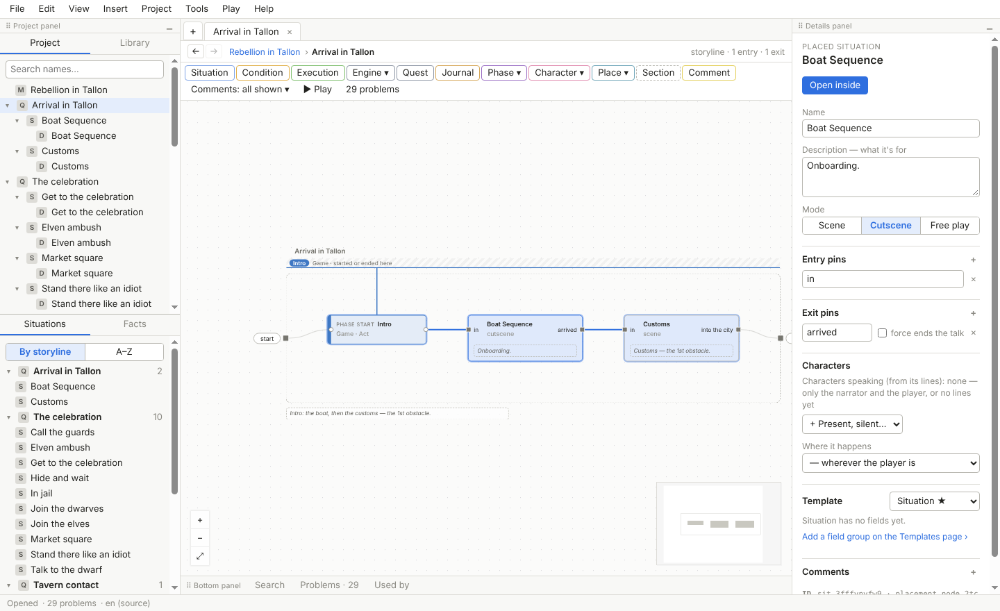

# The Storyliner guide

Storyliner is a tool for designing the quests and stories of a game. You lay a quest out as a map of
scenes joined by arrows, write the dialogue inside it, keep track of what the player knows and has
done, and play it as a text game while you write — with the real logic running, so you see what a
player would see. It saves everything in plain files you own, and it's built to take over from
articy:draft.

This is the guide of Storyliner 0.4.5, and it shows only what's built. It's public — anyone can read it, no
GitHub account needed: it's kept with Storyliner's releases, at
[github.com/Tvejzer/Storyliner-releases](https://github.com/Tvejzer/Storyliner-releases), a copy with each
release. In the app, *Help ▸ Guide* opens the guide of the version you have.
Each page explains its words as it goes; any word you meet without one is in the [Glossary](glossary.md).

## The pages

1. [Getting started](getting-started.md) — install and update Storyliner, open a test project, find your way round the window, save, and undo.
2. [The project and the project map](project-and-map.md) — what a project holds, and the map of all its storylines at once.
3. [Canvases, nodes and wires](canvases.md) — make nodes, connect them, select, group into sections, comment, copy and paste, rearrange.
4. [Writing dialogue](dialogue.md) — lines and who says them, choices and hubs, lines that change with the world, menu text, timing, markup and game values.
5. [Characters](characters.md) — a character's sheet, the wheel of things to talk about, entry lines, one-liners, generic NPCs and pools.
6. [Facts, conditions and world states](facts-and-conditions.md) — what the game remembers, how a line or an option depends on it, and saved starting points.
7. [Quests, events and triggers](quests-and-events.md) — quests and their states, what the story tells the engine, and what the engine tells the story.
8. [Phases](phases.md) — the stages a world goes through, and the tools that show what changes in each.
9. [Locations and scene lists](locations.md) — the places of the world, and which scenes play there.
10. [Templates and fields](templates.md) — your own kinds of things, and the fields they carry.
11. [The journal, the codex and interface text](journal.md) — what the player's journal shows as a quest goes on, codex pages, and the game's interface words.
12. [Reading tools](reading-tools.md) — search, *Used by*, and ways to read a story straight through.
13. [Play mode and the playable HTML file](play-mode.md) — play your quest in its own window beside the canvas, and share it as one file.
14. [The validator](validator.md) — the problems Storyliner finds, and how to deal with each.
15. [Importing](importing.md) — bring a story in from articy:draft, Twine, Ink, Yarn Spinner or your notes, with an AI agent's help.
16. [Files, settings and keyboard shortcuts](files-and-settings.md) — what's in the project folder, where settings live, and every shortcut.
17. [Glossary](glossary.md) — Storyliner's words, a sentence each.

## The test projects

The pictures in this guide come from three of your quests, which you can open and try things in:

- **Rebellion in Tallon** — a quest written as an outline: scenes, choices and where they lead.
- **Kill the Dragon** — a quest written in Twine, with characters and a journal.
- **The Fallen Leaves** — a chapter written in articy:draft, brought in with the import kit.

Open them from the *Projects* folder of your copy of the Storyliner folder: [Getting started](getting-started.md)
says how. Some pictures use the copies kept for Storyliner's own checks, in the *fixtures* folder, so a
quest there can be laid out a little differently — the Rebellion in Tallon there is one storyline, not six.

## What's coming

What Storyliner will do after this, stage by stage:

- **Documents** — quest documents you could hand someone, made from the graph.
- **Translations** — every player-facing text in other languages, with the translation view and
  translator sheets.
- **Voice-over** — recordings for every line, recording scripts, and play mode playing them.
- **The Unreal plugin** — your quests in Unreal Engine, played by the same rules as play mode.
- **Live documentation** — documents that change as you edit, with nothing to export.

---

Spec: §1, §3
