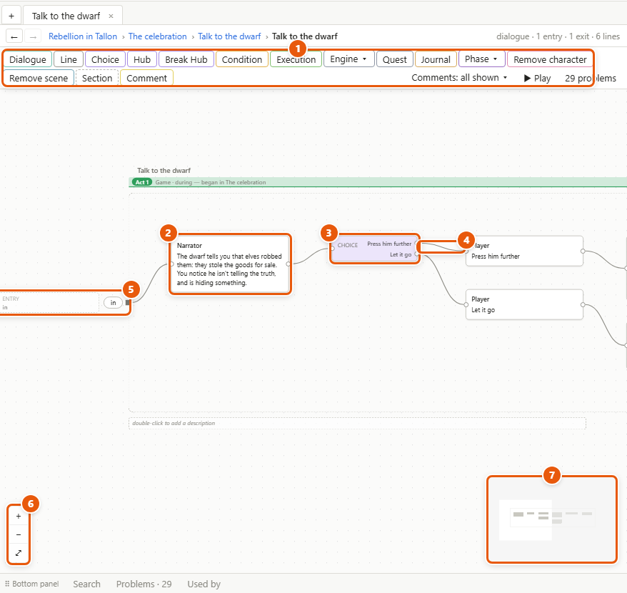
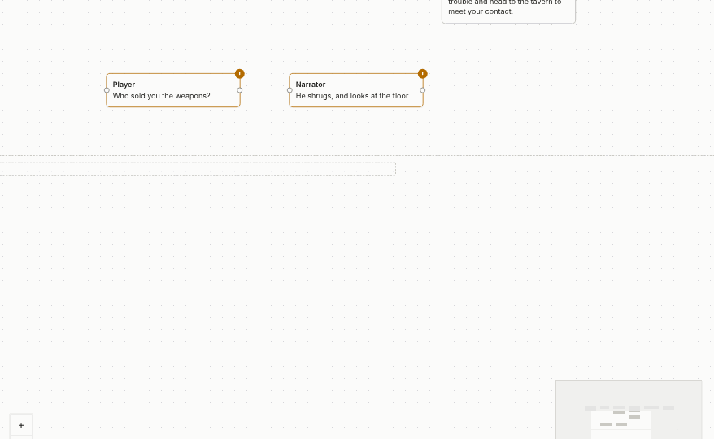
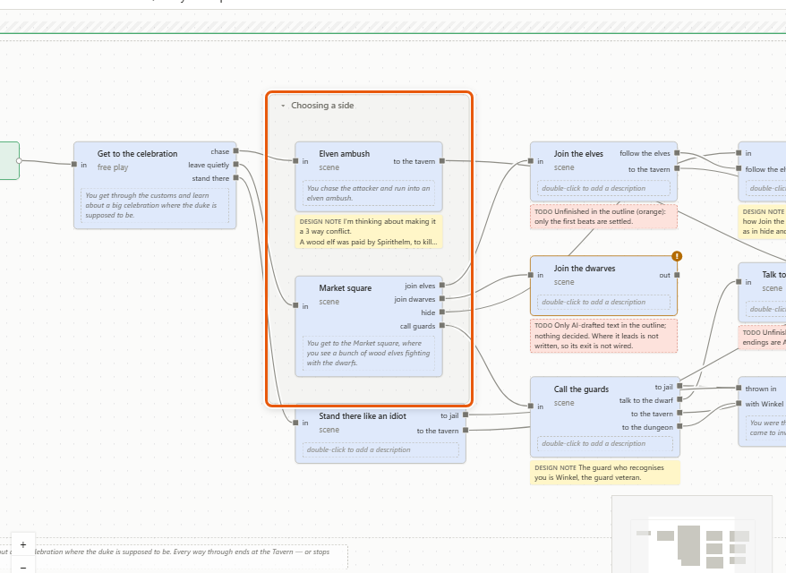
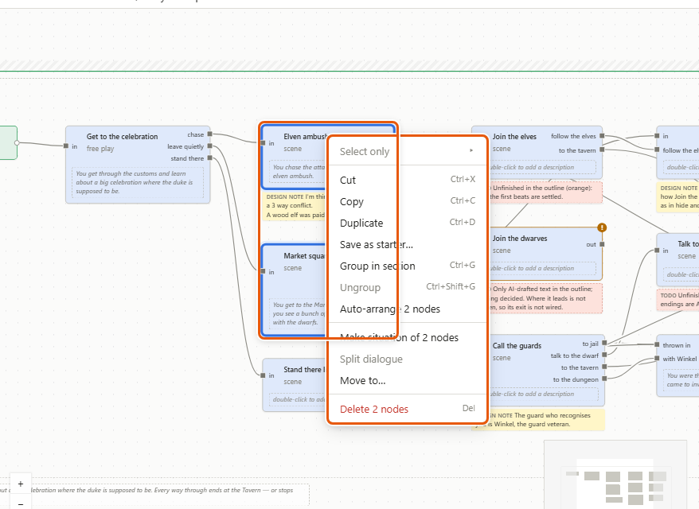
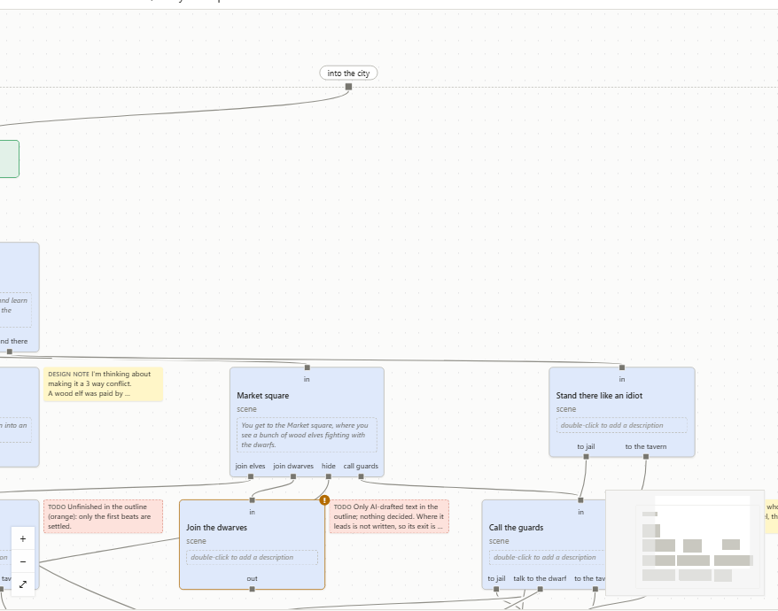

# Canvases, nodes and wires

A canvas is where you build the story: inside a storyline, a situation or a dialogue. You put nodes on it — lines, choices, conditions, placed situations — and wire them with arrows in the order they play. This page is how to make, connect, select and rearrange them.

## What's on a canvas

1. **The toolbar** along the top adds the nodes this canvas may hold. A storyline holds situations and the logic between them: Condition and Execution nodes and the like. A situation holds dialogues too. A dialogue holds lines, choices and hubs, logic of its own and dialogues inside it, but no situations.
2. **Nodes.** Each is a box: a line someone says, a Choice, a Condition, a placed situation, and so on. Its ways in are dots — *pins* — on its left side, its ways out on its right.
3. **Choices and Hubs** have one way out per option, each with its name.
4. **Arrows** go from a way out to a way in. The story follows them.
5. **The frame's pins.** The dashed box around everything — the frame — is the storyline, situation or dialogue you're in. Its own pins sit on the frame: entries on the left, exits on the right. They are its doors to the canvas around it. Beside a door, a faded *ghost* shows what's on its other side outside — what leads in to an entry, where an exit goes; double-click a ghost to go there.
6. **+, − and ⤢** zoom in, zoom out, and show the whole canvas.
7. **The minimap** shows the whole canvas, small; the box is what's on screen. *View ▸ Minimap* hides it.

## Move around

- Drag with the right or the middle mouse button, or hold *Space* and drag, to move the canvas.
- The mouse wheel zooms. On a touchpad, two fingers move the canvas and a pinch zooms. If Storyliner guesses your mouse or touchpad wrong, set it in *View ▸ Scrolling*.
- Double-click a placed situation or a dialogue to open it. *Ctrl+double-click* opens it in a new tab.
- Double-click empty canvas outside the frame to go up one level, all the way to the project map (see [The project and the project map](project-and-map.md)). *View ▸ Up one level* does the same.
- *View ▸ Go back (Alt+←)* and *View ▸ Go forward (Alt+→)* return to what you had on screen before, like a browser's arrows. So do the ← → buttons at the left of the [breadcrumb](glossary.md#b) — the path above the canvas — and the mouse's side buttons.

## Make a node

1. Click a toolbar button. The node lands at the free spot nearest the middle of the view, selected.
2. Or drag the button onto the canvas: the node lands where you drop it. A node with one way in and one way out — a line, an Execution and the like — dropped onto an arrow is put into it: *A → B* becomes *A → new → B*.
3. Or right-click empty canvas ▸ *Add here*, or use the *Insert* menu.
4. Buttons with **▾**, such as *Engine ▾* or *Phase ▾*, offer a few kinds: click one in the list, or drag it from there.

A new node starts ready to use: a line after another line gets the other speaker of the two, so a back-and-forth needs no clicking. See [Writing dialogue](dialogue.md).

## Connect two nodes

1. Point at the way out of the first node — the dot on its right side.
2. Press the mouse button and drag to the way in of the second node — the dot on its left — and let go. The arrow is drawn.
3. To add a node that's already connected, drag from a way out and let go on empty canvas. A menu of nodes opens right there; pick one. After a Choice's or a Hub's option it offers only *Player line* and *Condition*. A line made this way is ready to type into straight away. Press *Enter* to keep the text.

- **One arrow per way out.** Drawing a new one from a way out that has one already replaces it. Undo brings the old one back.
- **Into a placed situation:** drop the arrow on the entry pin you mean, the dot on its left side.
- **Break an arrow:** *Alt+click* it, or right-click it ▸ *Delete arrow*. *Alt+click* a pin breaks every arrow on it.
- **Move arrows:** *Ctrl+drag* from a pin picks up its arrows and drops them on another pin.
- **Put a node into an arrow:** right-click the arrow ▸ *Insert node here*.
- **Loops are fine** — back to the tavern, try again. But an arrow can't go from a node straight back into itself while *Edit ▸ Block arrows into the same node* is ticked — and it's ticked to begin with.

## Select

1. Click a node to select it. Its details show on the right.
2. *Shift+click* adds a node or an arrow to the selection, or takes it out.
3. Drag on empty canvas to draw a selection box. It takes in what's wholly inside it — the project's setting *Edit ▸ Selection box: 100% inside…* says how much must be inside.
4. *Ctrl+A* selects everything on the canvas.

With several things selected, the details panel says what they are, by kind — *3 lines*, *1 choice* — and a click on one kind narrows the selection to it, so you can change them all at once. *Edit ▸ Select only* does the same.

With one node selected, everything on the canvas that leads to it, and everything it leads to, is outlined, and the rest fades. *View ▸ Highlight paths* switches that off.

## Edit on the canvas

Double-click what a node shows to change it right there: a line's text or speaker, an option's name, a dialogue's or a situation's name, a pin's name, a comment, a Condition's check, an Execution's assignments. *Enter* keeps it; *Escape* leaves it as it was. Each change is one undo step.

Double-click the name above the frame to rename what you're in.

## Sections and comments

- **A section** is a box that groups nodes under a heading. Select the nodes and press *Ctrl+G* (*Edit ▸ Group in section*), or click *Section* on the toolbar. Drag a section by its name to move it with everything in it; double-click the name to rename it. Click **▾** beside the name to fold it into a bar, and **▸** to unfold it — that's only for you. *Ctrl+Shift+G* (*Edit ▸ Ungroup*) takes it away and leaves what was in it.
- **A comment** is a note on the canvas. Click *Comment* on the toolbar and choose its kind — its category. *Comments: all shown ▾* on the toolbar, or *View ▸ Comment categories*, shows and hides each category, only for you. To tie a comment to nodes, select it and them, right-click the comment ▸ *Link to the other selected nodes and arrows*.
- **Colour:** right-click a node ▸ *Colour*.

## Copy, paste, duplicate and delete

- *Ctrl+C* copies, *Ctrl+X* cuts, *Ctrl+V* pastes at the free spot nearest the middle of the view, *Ctrl+D* duplicates next to the original. They're in the *Edit* menu and on the right-click menu too.
- A copy is a new, separate thing. Cut and paste is a move: it stays the same thing, so whatever pointed to it still does.
- Pasting a placed situation makes a new situation, *… (copy)*. To place the same situation again, use *Edit ▸ Paste as placement*.
- Pasted where it can't go — lines into a storyline, say — what you paste is wrapped in a dialogue, or a situation, that can hold it.
- *Del* — the Delete key — or *Edit ▸ Delete* deletes what's selected. A node's arrows go with it; if it had one arrow in and one out, those are joined, so the chain stays whole.
- Deleting a placed situation removes only that placement: the situation stays in the *Situations* list. *Delete situation everywhere…* on its right-click removes it from the whole project, after showing where it's placed.

## Break open and move

These are in *Edit ▸ Restructure*, and on the right-click menu of a selection. Each is one undo step.

- **Make situation:** the selected nodes move into a new situation, placed where they were. Arrows that crossed the selection's edge become its pins. In a dialogue it's *Make dialogue*: the nodes go into a new dialogue inside it.
- **Break open:** a placed situation's contents come out onto this canvas, wired where its pins were, with a section left around them. It's on the placed situation's right-click, and asks before it does it. If the situation is placed in other places too, a copy is broken open for this spot only, and the others are left alone. A dialogue inside a dialogue breaks open the same way.
- **Split dialogue:** inside a dialogue, the selected nodes move into a new dialogue beside it, wired through pins.
- **Make situation of a section:** right-click the section ▸ *Make situation of it*, or *Edit ▸ Restructure ▸ Make situation of section*. The section becomes a situation, with its name.
- **Move to…:** moves the selection into another storyline, situation or dialogue. Arrows that would have to cross into the other canvas are dropped; a message says how many, so you can rewire them through pins.
- **Auto-arrange** lays out the selected nodes — or the whole canvas, with one node or none selected — left to right in the order the arrows run.

## Top to bottom

1. Choose *View ▸ Top to bottom*. Every canvas and the project map turn a quarter: the story runs down. Ways in are on top of each node, ways out at the bottom.
2. Choose it again to go back to left to right.

It's only how you see it: turning changes nothing in the project, and other people keep whichever way they chose. A node you move while turned keeps that place for the top-to-bottom view. Right-click it ▸ *Back to the automatic place*, or right-click the canvas ▸ *Everything back to automatic places*, to forget it.

## Details and tips

- **⤢ shows the whole canvas** when you're lost.
- **Hover on empty canvas** for a couple of seconds: a tooltip says how to move around.
- **Where new things land:** at the free spot nearest the middle of the view, clear of other nodes, and always brought into view.
- **A double-click is never followed by a stray click,** so a touchpad's accidental triple-click does nothing.
- **Where arrows cross,** the lower one has a little gap. Point at an arrow and it turns bold, and the others fade after a moment.
- **Drag a character** from the *Library* onto a dialogue's canvas to add an empty line he speaks.

---
← [The project and the project map](project-and-map.md) · [Guide home](README.md) · [Writing dialogue](dialogue.md) →

Spec: §4.6, §4.7, §4.18, §4.19, §7 (the canvas), §7.3, §7.4, §7.5, §7.6
