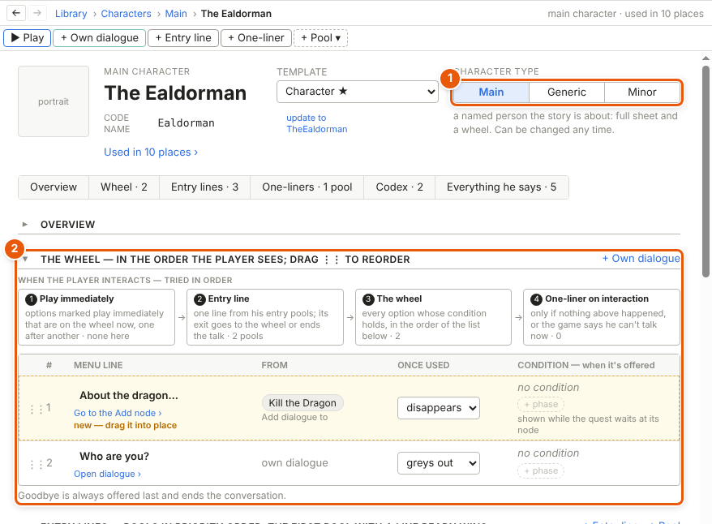
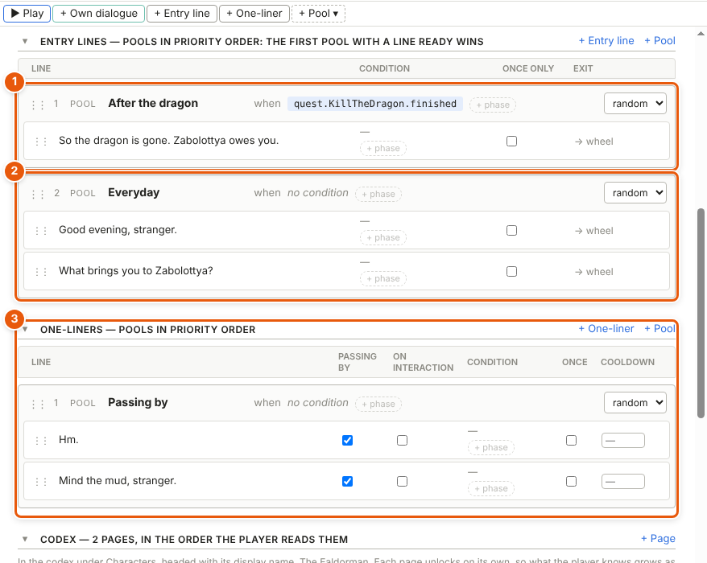

# Characters

Everyone who speaks a line is a character, even a guard with one line. A character's sheet is where you write what he says when the player walks up to him: the options on his conversation wheel, his greetings, and the short lines he says in passing. The game picks among them by itself, by the conditions and the order you give.

1. His character type. 2. His wheel: the options the player sees when talking to him, in order. Above the list, *When the player interacts — tried in order* sums up what the game tries first.

## Make a character

1. Open the **Library** tab of the left panel.
2. Click **+** beside **Characters**, type a name and press **Enter**. Or use *Project ▸ New character…*. He starts as a main character, and his sheet opens in a tab.
3. Or, while writing a line, type a new name and a colon in front — *Old guard: Halt!* — and click **Create character “Old guard”** under the text in the details panel. That character is made **minor**, and filed in the Library's *Minor* group.

Click a character in the Library to open his sheet again; Ctrl+click opens it in a new tab.

## Choose his type

At the top of the sheet, under **Character type**, pick one:

- **Main** — a named person the story is about: a full sheet and a wheel.
- **Generic** — one sheet for many [NPCs](glossary.md#n) (people in the game the player doesn't control), such as every guard or merchant. Each NPC remembers on its own: what one guard has said, another can still say.
- **Minor** — lines only: no fields and no wheel. Someone who appears once or a few times.

You can change it at any time. Things the player can use that aren't people — a notice board, a letter on a table — are characters too, usually generic or minor.

## Fill his wheel

The wheel is the menu of options the player sees when he talks to the character. It shows every option whose condition holds, in the order of the list on the sheet.

1. Click **+ Own dialogue** on the sheet's toolbar. A new option of his own appears in the wheel's list.
2. In its **Menu line** column, type what the wheel shows, such as *Who are you?*. The details panel has it too, as **Menu text — what the wheel shows**.
3. Click **Open dialogue ›** to write the talk it plays, as any dialogue — see [Writing dialogue](dialogue.md). Its exits go **back to the wheel** or end the conversation.
4. Under **Once used**, pick what happens after it's been picked: it **greys out** but can still be picked, **stays** as it was, or **disappears**. The wheel remembers for good.
5. In the **Condition — when it's offered** column, double-click to type a condition (see [Facts, conditions and world states](facts-and-conditions.md)). It's kept as an *Option condition* node at the start of the dialogue; empty it and the node goes.
6. Drag **⋮⋮** to change the order. *Goodbye* is always offered last and ends the conversation.

Options a quest adds appear in the same list, marked with the quest's name and *new — drag it into place*. They come from **Add dialogue to** nodes — see [Quests, events and triggers](quests-and-events.md).

## Write his greetings and his one-liners

1. Click **+ Entry line** for a greeting: the line he says first when the player walks up, before the wheel opens. Type it in the list, or in the details panel.
2. Click **+ One-liner** for a short line he says in passing, or when he won't talk.
3. A new line starts in a *pool* of its own — a pool is a group of lines the game picks one from — drawn as a plain line. Drag another line onto it to make a pool of two (2), or use **+ Pool ▾** for an empty one.
4. Name the pool, and double-click after **when** to type its condition (1). Pick **random** or **in order** on its right.
5. Drag the pools into order. The first pool with a line ready wins, then one line is picked from it. Here *After the dragon* takes over once the quest is finished; until then he says one of his *Everyday* lines.
6. For a one-liner (3), tick when it can play: **Passing by**, **On interaction** — he won't talk — or another occasion the game asks for.

## Details and tips

- **What the game tries, in order,** when the player walks up: an option marked **Play immediately**, then an entry line, then the wheel, then — if none of those had anything — a one-liner marked *on interaction*. The four boxes above the wheel show this, with how many each has.
- **Play immediately.** Select one of his options and tick **Play immediately** in the details: walking up to him plays it at once, with no greeting, and it's never offered as a choice. When it's over, the next option marked so plays, then the wheel opens — unless it ended the conversation. The wheel's list marks it with a badge.
- **Once only and cooldowns.** An entry line can be **Once only** — "So you're the one they sent" only the first time. A one-liner can be **Once only** too, or have a **Cooldown — seconds of game time**.
- **A pool points to lines, it doesn't own them.** One line can sit in several pools. Taking it out of a pool leaves it on the sheet; a line in no pool never plays, and the sheet marks it.
- **Occasions.** Besides passing by and on interaction, the game can ask for a one-liner on its own moments — *spotted*, *combat_start*. Declare them in *Tools ▸ Occasions* with **+ New occasion**; each then has its own tick box in a one-liner's details, under **When it can play — at least one**.
- **Places.** Under **Found in**, in his overview, pick the locations he can be found in from **+ Add location**: their lines and pools appear further down his sheet, ready to drag into his own pools. A location's line plays only while he is there. See [Locations and scene lists](locations.md).
- **Everything he says.** The last part of the sheet lists every line he speaks anywhere in the project, grouped by storyline, situation and dialogue. It's the same line as on its canvas, not a copy: edit it here or there. *View ▸ Character view…* asks whose lines, and opens his sheet at that list.
- **Lines with no speaker.** *Tools ▸ Assign speakers…* lists them all; tick any number, pick a speaker, and they're all set in one step.
- **Generic characters in play mode.** Talking to a generic character, play mode asks *Talk to which Guard?* — type 1, 2 or any name for the NPC — so you can see that each remembers his own talks.
- **Try it.** **▶ Play** on the sheet's toolbar talks to him in play mode's own window, as the player would. See [Play mode and the playable HTML file](play-mode.md).

---
← [Writing dialogue](dialogue.md) · [Guide home](README.md) · [Facts, conditions and world states](facts-and-conditions.md) →

Spec: §4.12, §4.16, §5.4, §7.10
