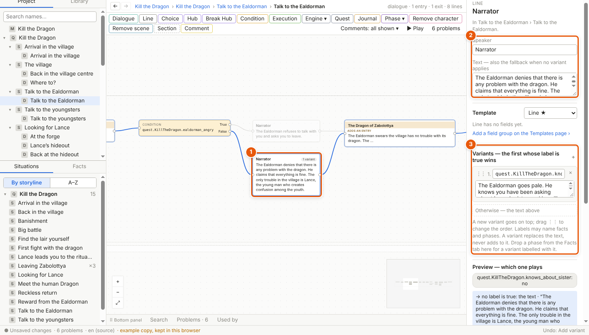
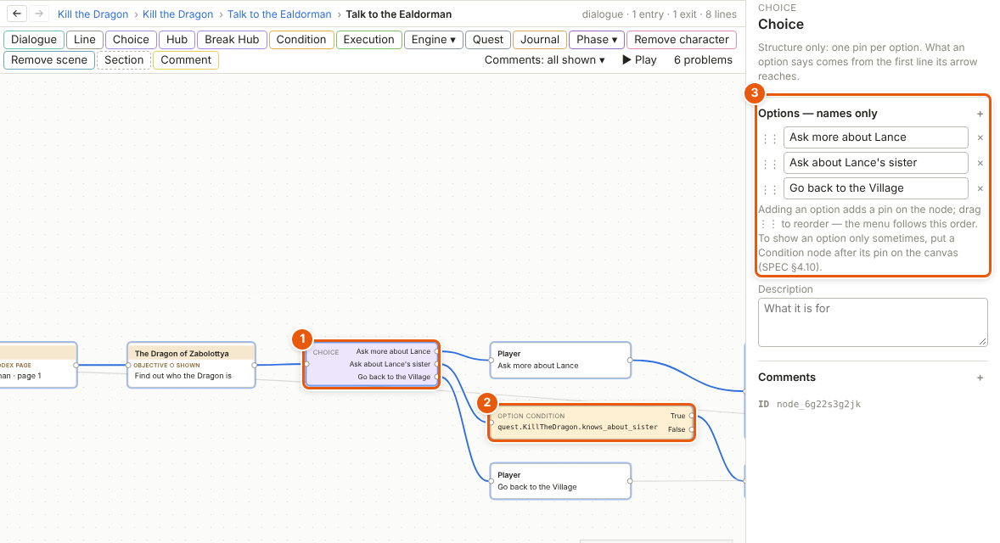
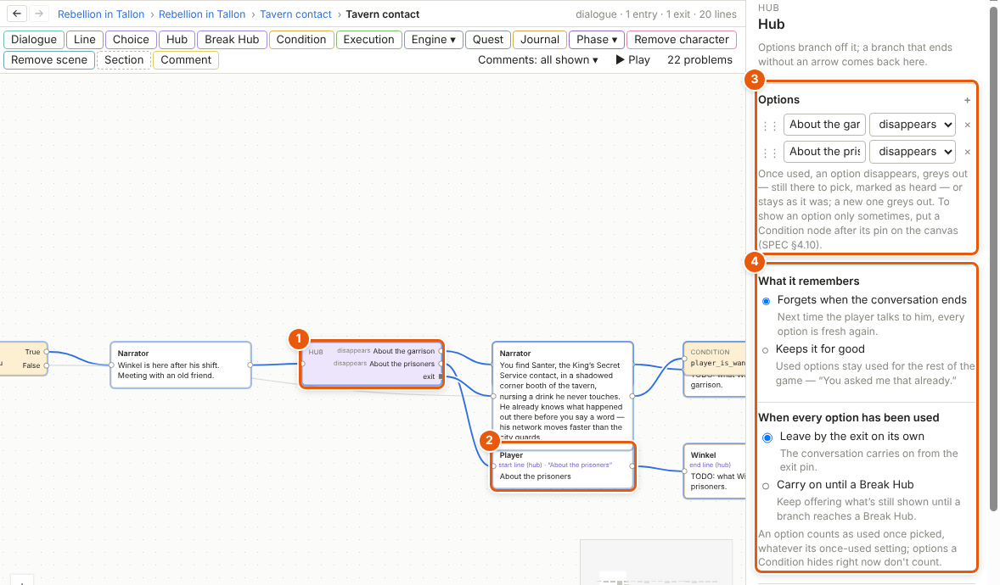

# Writing dialogue

A dialogue is a conversation, written as lines wired one to the next on its own canvas. Choices and hubs give the player options; variants let a line change with the world, so you write a line once and it reads right in every part of the story.

1. The line on the canvas. 2. Its speaker and its text, in the details panel. 3. Its variants: other versions of the line, each for a moment in the story.

## Make a dialogue

1. Open a situation's canvas: click the situation in the Project tab, or double-click its box on the storyline's canvas.
2. Click **Dialogue** on the toolbar above the canvas, or drag it onto the canvas.
3. Double-click the new dialogue to open its own canvas. That's where its lines go.

A dialogue has one way in and as many ways out as you need. A linear talk is a short chain of lines; a talk with choices fans out and either joins up again or leaves by different exits.

## Write a line

1. On a dialogue's canvas, click **Line** on the toolbar. Or drag from a node's way out, let go on empty canvas and pick **Line** in the menu that opens (after an option it's **Player line**): the new line arrives already wired.
2. Double-click the line's text on the canvas to write it right there. **Enter** keeps it, **Shift+Enter** starts a new line in the text, **Escape** leaves it as it was.
3. To say who speaks, type the name and a colon in front: *Ealdorman: Good evening, stranger.* Storyliner sets the speaker and keeps only the words. *player:* and *narrator:* work too.
4. A name that isn't a character yet stays in the text, and the details panel offers **Create character “…”** under it: click it to make him and set him as the speaker. He starts as a minor character — see [Characters](characters.md).

You can also pick the speaker in the details panel, under **Speaker**, or double-click the speaker's name on the line's box and type it there; a new name offers **Create character** in both. A line with no speaker is shown in the problems list until it has one (see [The validator](validator.md)); *Tools ▸ Assign speakers…* gives many lines a speaker at once.

## Give the player a choice

1. Click **Choice** on the toolbar. The Choice (1) is structure only: one pin per option.
2. In the details panel, under **Options — names only** (3), name each option. The name is what the menu shows the player: *Ask about Lance's sister*. Click **+** to add one; drag **⋮⋮** to change the order.
3. Wire each option's pin to the line the player says when he picks it. That line is spoken, so it can have variants like any line.
4. To show an option only sometimes, put a **Condition** node between its pin and its line (2). On the canvas it is drawn as an *Option condition*. When its check is false and nothing is wired to *False*, the option isn't offered at all.

An option with no condition always shows.

## Let the player ask about anything: hubs

A hub is the "ask me about anything" node (1). Options branch off it; when a branch ends without an arrow, the talk comes back to the hub, which remembers which options were used.

1. Click **Hub** on the toolbar and name its options in the details panel (3), as for a Choice.
2. For each option, pick what happens once it has been used: it **disappears**, **greys out** (still there to pick, marked as heard), or **stays** as it was. A new option greys out.
3. Under **What it remembers** (4), choose **Forgets when the conversation ends** or **Keeps it for good** — "you asked me that already".
4. Under **When every option has been used**, choose **Leave by the exit on its own**, or **Carry on until a Break Hub**.
5. To let the player leave whenever he likes, add an option such as *Goodbye* and wire it to a **Break Hub** node. A Break Hub leaves the hub and carries on from its own way out.

Lines in a branch show their part on the canvas: the *start line (hub)* an option leads to (2), lines in the branch, and the *end line (hub)* after which the talk goes back. An end line's **Back to the hub** box in the details is ticked; untick it and a Break Hub is put after the line for you.

In a hub that keeps what's used for good, a start line offers **+ Asked again** in its details: what is said when the player picks that option again — later in the same conversation, or in a later one.

## Make a line change with the world: variants

1. Select the line. In the details panel, find **Variants — the first whose label is true wins**.
2. Click **+**. A new variant goes on top.
3. Type its label — a condition, such as *quest.KillTheDragon.knows_about_sister* — and its text. Autocomplete helps with the names; see [Facts, conditions and world states](facts-and-conditions.md).
4. Drag **⋮⋮** to put the variants in order. The order is the priority: the first variant whose label is true is the one said, in place of the line's own text.
5. Under **Preview — which one plays**, click a fact to switch it and see which version would play. The preview changes nothing in the project.

A variant always replaces the whole line, never adds to it, so every line the player hears is one piece: one translation, one recording. The line's own text is the fallback, said when no label is true. Tick **Phaseless — ignore variants, always use the text** for interface lines and traders.

## Details and tips

- **Menu text.** A Choice or Hub menu shows each option's name. With *File ▸ Project settings…* ▸ **Menu text on options** ticked, the line an option leads to can have a menu text of its own, with variants, and the menu shows that instead — so an option's wording can change with the world. A wheel's options always have a menu text: see [Characters](characters.md).
- **Timing.** Under **Timing**, **Duration — seconds** is how long a line stays before the talk goes on by itself; **Pause after** adds a wait after it. Left empty, the line uses the project's defaults — *File ▸ Project settings…* ▸ **Default line duration — seconds** and **Pause after each line — seconds**. With no duration anywhere, the line waits for the player.
- **Markup.** A line can hold a little markup, shown as written on the canvas and as styled text in play mode:

  | Written | Means |
  |---|---|
  | `*words*` | emphasis |
  | `**words**` | strong emphasis |
  | `{player_name}` | a value the game fills in when it plays — a game value |
  | `[pause 0.5]` | a pause, in seconds, before the rest of the line |

- **Game values.** A `{placeholder}` has to be declared first: *Tools ▸ Game values*, then **+ New game value**. Give it a [code name](glossary.md#c): what you write between the { } in a line. Then pick its type, text or number, and give it a test value, which play mode shows in its place. Changing a game value's code name later rewrites every `{placeholder}` that uses it.
- **Conditions and facts in a talk.** A **Condition** node sends the talk down one way or another; an **Execution** node sets facts as the talk passes. Both are on the toolbar; see [Facts, conditions and world states](facts-and-conditions.md).
- **A dialogue inside a dialogue.** Select some nodes and use *Edit ▸ Restructure ▸ Make dialogue* to give part of a talk a box of its own. It plays exactly as if its lines stood in the dialogue around it.
- **See it play.** Select a line and press **Shift+F5** — *Play ▸ Play from here* — to play the talk from there in play mode's own window. See [Play mode and the playable HTML file](play-mode.md).

---
← [Canvases, nodes and wires](canvases.md) · [Guide home](README.md) · [Characters](characters.md) →

Spec: §4.8, §4.9, §4.10, §4.11, §4.15 (game values), §5.3, §7.5, §7.10
