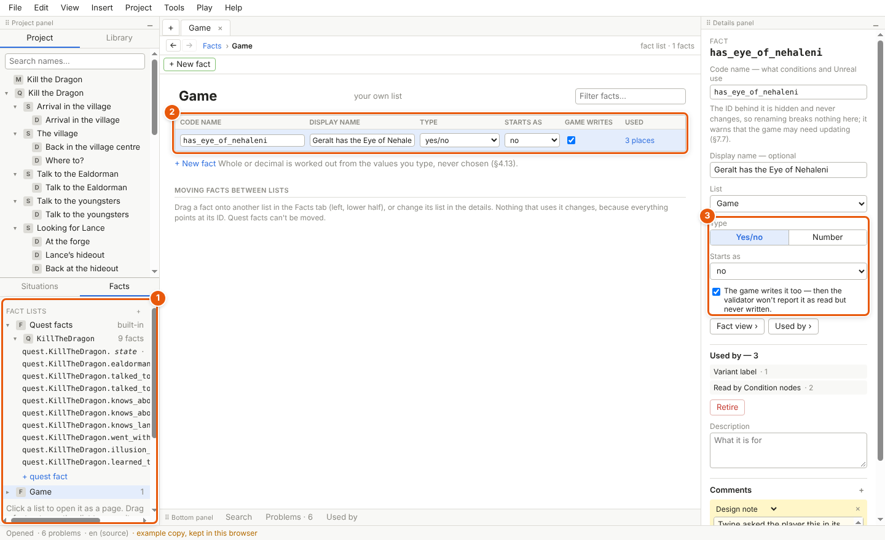
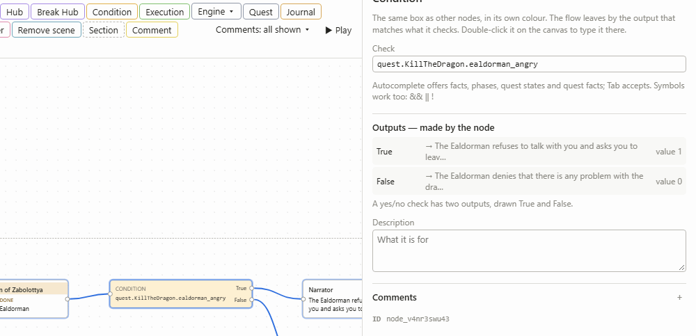
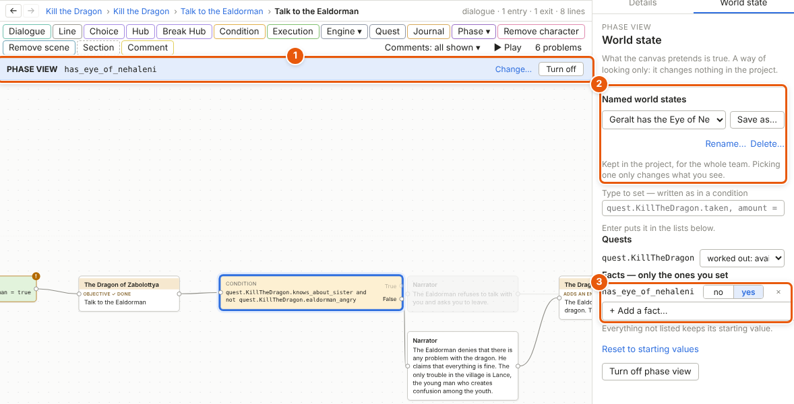

# Facts, conditions and world states

A fact is something the story remembers, under a name: *knows_about_sister* (yes or no), *gold* (a number). Conditions read facts to decide what happens — which way a talk goes, which version of a line plays, which options a character offers. A world state is a set of facts you name and keep, to look at the story as it would be at some point.

1. The **Facts** tab of the left panel: every fact list. 2. A list opened as a page. 3. The selected fact's type, what it starts as, and whether the game writes it too.

## Make a fact

1. Open the **Facts** tab of the left panel.
2. Click a list to open it as a page. Click **+** beside **Fact lists** to make a new list of your own — *mood*, *knowledge*, *village*.
3. On the list's page, click **+ New fact**. Type its **Code name** — the name conditions and the game use, in English letters, digits and underscores — and click **Create**. The new fact is selected; give it a **Display name** in the details if you like.
4. Pick its **Type** in the details: **Yes/no** or **Number**. Storyliner works out by itself whether a number is whole or decimal, from the values you give it.
5. Pick what it **Starts as**. Tick **The game writes it too** for a fact the game sets — then the [validator](glossary.md#v), Storyliner's checks, won't report it as read but never written.

The quicker way: type a name that doesn't exist yet in any condition or [Execution node](glossary.md#e). Storyliner offers **Create fact** right there, guesses its type from how you used it, and puts it in the list you used last — or the one you pick beside it.

## Facts that belong to a quest

Each [quest](glossary.md#q) has a state and facts of its own, under **Quest facts** in the Facts tab, one folder per quest.

- Its state is one of five: *unavailable*, *available*, *taken*, *finished*, *failed*. Read it as *quest.KillTheDragon.finished*. Its *Available when* condition, Quest nodes, and the story reaching one of its exits change it — never an Execution node. See [Quests, events and triggers](quests-and-events.md).
- Its own facts are yes/no facts read as *quest.KillTheDragon.dragon_spared*. Add one with **+ quest fact** in its folder, or type a new name after the quest's: Storyliner offers **Create quest fact**.

Phases are facts too — on while a period of the story lasts — and have their own part of the Facts tab: see [Phases](phases.md).

## Type a condition

1. Put a **Condition** node on a [canvas](glossary.md#c), from the toolbar, and select it.
2. Click in **Check** in the details panel — or double-click the node to type on the canvas.
3. Start typing. Suggestions show facts, phases, quest states and quest facts, each with its type. Keep typing to narrow them; **Tab** or **Enter** takes the one highlighted.
4. When no suggestion is showing, press **Enter**, or click elsewhere, to keep it. The node leaves by **True** or **False**.

A condition is written like this:

| Written | Means |
|---|---|
| *knows_about_sister* | a yes/no fact is true |
| *not ealdorman_angry* | it's false |
| *gold >= 50* | compares a number: **==** is, **!=** isn't, **<** less than, **<=** at most, **>** more than, **>=** at least |
| *knows_about_sister and not ealdorman_angry* | both; *or* for either; brackets to group |
| *quest.KillTheDragon.finished* | a quest's state |
| *reputation.Rebels > 10* | a [faction](glossary.md#f)'s reputation |
| *Lance.location == Hideout*, *player.location in Zabolottya* | where someone is; *in* counts everything inside a place |

Symbols work as well as words: **&&** for *and*, **||** for *or*, **!** for *not*. *File ▸ Editor settings…* ▸ **Write conditions back as** picks how they're shown.

## Set facts as the story passes

1. Put an **Execution** node on the canvas, where the flow passes — the flow is the story moving along the arrows.
2. Under **Assignments — one per line**, type what it sets: *talked_to_ealdorman = true*, *gold += 50*, *gold -= 10*. A fact on its own means *= true*.
3. Press **Ctrl+Enter**, or click elsewhere, to keep it.

An Execution node can't change a quest's state or start a phase: Quest nodes and phase nodes do that.

## Name a world state

1. Turn on *View ▸ Phase view* — the canvas shown as the story would read in the world you set (more in [Phases](phases.md)). A **World state** tab opens beside **Details**, and a strip above the canvas says what's set (1).
2. Under **Facts — only the ones you set**, add facts with **+ Add a fact…** and set them (3) — or type them in **Type to set — written as in a condition**. Everything you don't list keeps its starting value.
3. Under **Named world states** (2), click **Save as…** and give it a name — *Act two, at war, winter*.
4. Pick it again from the list whenever you like. **Rename…** and **Delete…** are under it. Change something after picking one, and **Keep this world as “…”** saves the change into it.

Named world states are kept in the project, for the whole team. Picking one only changes what you see. You can also start [play mode](glossary.md#p) in one — *Play ▸ World state…* — or pick one in the coverage grid and the phase diff (see [Phases](phases.md)). The validator looks in each one, as well as at the start, for characters with nothing to say during some phase.

## Details and tips

- **What uses a fact.** In a fact's details, **Used by ›** lists every place that reads or sets it; **Fact view ›** shows them all on one page. Double-click a fact in the Facts tab for its fact view.
- **Renaming is safe.** Everything points at a fact by a hidden ID, so a new code name changes nothing that uses it. Moving a fact to another list is safe too: drag it onto the list in the Facts tab, or pick another **List** in its details. Quest facts stay with their quest.
- **Deleting retires.** **Retire** moves a fact to its list's *Retired* section: nothing new can use it, and old game saves still recognise it. In that section, tick retired facts and click **Restore** to bring them back. Once no old saves matter, **Empty the retired section…** deletes them for good — or *Project ▸ Empty retired facts…* empties every list's at once.
- **Mistakes never block you.** A condition that isn't finished, or names something unknown, is kept exactly as typed and underlined, with a note saying what's wrong. It counts as false until it's fixed, and the problems list shows it.
- **Numbers in a Condition node.** A check that gives a number, such as *rumours_heard*, gets an output per value you add with **+ Add a value**, plus **Otherwise** for any other value.
- **Decimals** are best compared with **<** and **>**: the validator warns about **==** on a decimal number.
- **An option's condition.** A Condition node right after a Choice's or Hub's option, or at the start of a wheel option, decides whether that option is offered at all — see [Writing dialogue](dialogue.md) and [Characters](characters.md).

---
← [Characters](characters.md) · [Guide home](README.md) · [Quests, events and triggers](quests-and-events.md) →

Spec: §4.13, §4.14, §5.1, §7.8, §7.9, §7.11 (world states)
