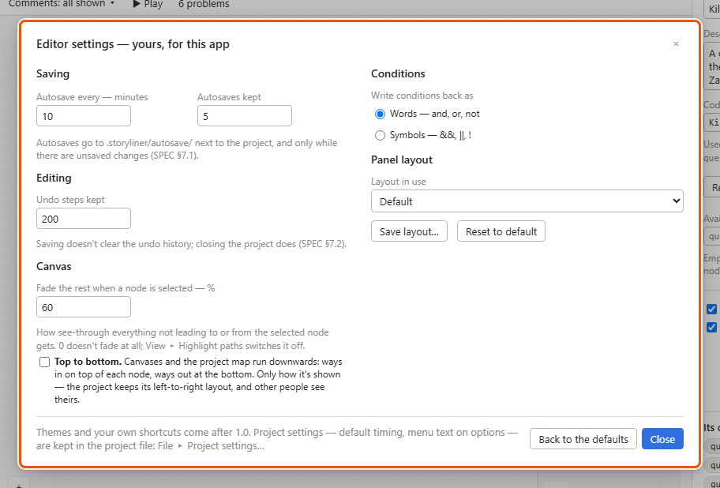
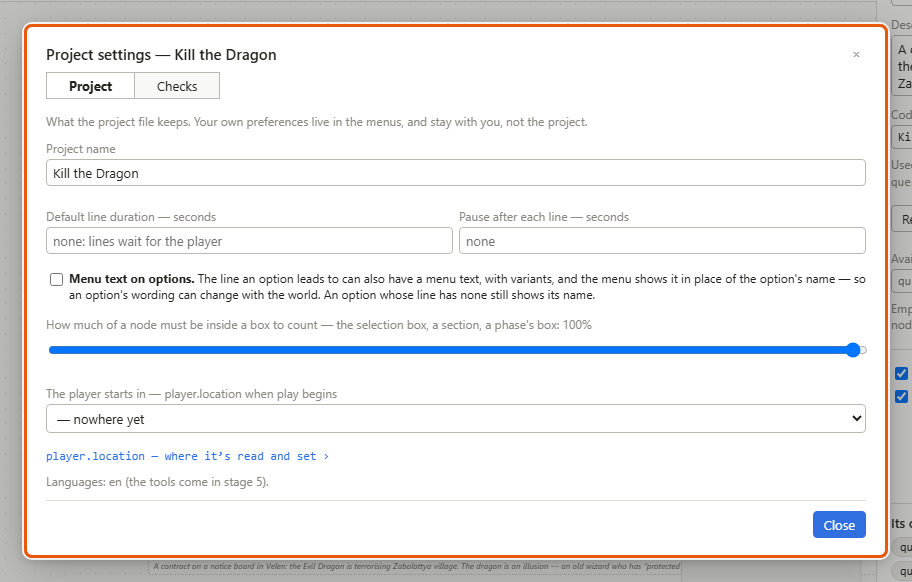
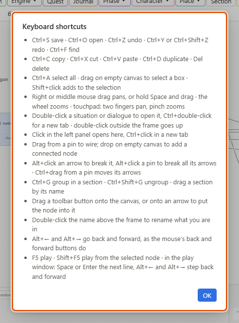

# Files, settings and keyboard shortcuts

This page says what Storyliner keeps on disk and where, which settings belong to the project and which to you, and lists the keyboard shortcuts, by where you use them. Any word it doesn't explain is in the [Glossary](glossary.md).

## The project folder

A project is a folder. Inside it:

- **The project file** — *Rebellion in Tallon.quest*, say. It holds the whole project: every storyline, situation, line, character, fact and setting, and where you put each node. It's the file you save, and the one your version control keeps — the tool your team shares files through and keeps their history in, such as Diversion.
- **translations** — one file per translation language, when there are any. Translating comes in a later version.
- **resources** — pictures, such as portraits. They are never copied into the project file; the project points at them.
- **import** — what importing left: the report on each outline you imported, and the mapping file that lists the old IDs beside the new. See [Importing](importing.md).
- **.storyliner** — yours alone, never part of the project. Tell your version control to ignore it. It holds:
  - *autosave* — the autosaves, and copies set aside when the file changed on disk (see [Getting started](getting-started.md));
  - *play* — your play mode run, so it's picked up where you left it (see [Play mode and the playable HTML file](play-mode.md));
  - *view.json* — how you look at the project: which [sections](glossary.md#s) and phase [boxes](glossary.md#b) are folded, which [comment](glossary.md#c) categories are shown, which tracks' phase boxes are shown, the [phase view](glossary.md#p)'s world state and the phase you're writing for, where you dragged the [project map](glossary.md#p)'s boxes and which of its kinds of arrow it hides, and the warnings you [suppressed](glossary.md#s), with their notes;
  - *lock.json* — says the project is open, so a second window opens it read-only (see [Lock](glossary.md#l)).

Saving is safe. Storyliner writes to a new file first and then swaps it in, so a crash mid-save never leaves half a file. It also checks that the file on disk hasn't changed since you opened or last saved it.

## Settings: the project's, and yours

There are two windows of settings, both in the *File* menu.

- *File ▸ Project settings…* — kept in the project file, so everyone who opens the project gets them. Changing one is one undo step.
- *File ▸ Editor settings…* — yours, for this app. They're never in the project and never part of undo.

### Change your editor settings

1. Choose *File ▸ Editor settings…*.
2. Change what you want. It takes effect at once. The numbers in brackets are where each starts:
   - *Autosave every — minutes* (10) and *Autosaves kept* (5);
   - *Undo steps kept* (200);
   - *Fade the rest when a node is selected — %* (60). 0 doesn't fade at all;
   - *Top to bottom* — canvases and the project map run downwards;
   - *Write conditions back as*: *Words — and, or, not* or *Symbols — &&, ||, !*;
   - *Layout in use*, *Save layout…* and *Reset to default*, for the panels.
3. *Back to the defaults* puts the autosaves, undo steps, fading and how conditions are written back as they started; *Top to bottom* and the layout stay as they are. *Close* when you're done.

These are yours too, set in the menus: *View ▸ Minimap*, *View ▸ Highlight paths*, *View ▸ Top to bottom*, *View ▸ Scrolling* (touchpad or mouse), *View ▸ Layout*, and *Edit ▸ Block arrows into the same node*. Play mode's window opens where you last left it, at the size you left it — that's kept for you as well.

### Change the project's settings

1. Choose *File ▸ Project settings…* (or *Project ▸ Project settings…*).
2. On its *Project* tab:
   - *Project name*;
   - *Default line duration — seconds* and *Pause after each line — seconds* — with no duration, lines wait for the player to read on; with no pause, there's none (see [Writing dialogue](dialogue.md));
   - *Menu text on options* (see [Writing dialogue](dialogue.md));
   - *How much of a node must be inside a box to count* — for the selection box, sections and phase boxes; 100% unless you change it. *Edit ▸ Selection box: 100% inside…* opens this window too;
   - *The player starts in* — where play begins (see [Locations and scene lists](locations.md)).
3. Its *Checks* tab switches kinds of check on and off for the whole project (see [The validator](validator.md)).
4. Click *Close*.

## Keyboard shortcuts

*Help ▸ Keyboard shortcuts* lists the main ones. The tables below have the rest too, by where you use them. A menu item with a shortcut shows it beside its name.

### Files and the whole window

| Keys | What they do |
|---|---|
| *Ctrl+S* | Save (*File ▸ Save*) — in the play window too |
| *Ctrl+O* | Open a project (*File ▸ Open…*) |
| *Ctrl+Z* | Undo (*Edit ▸ Undo*) — while typing in the details panel too |
| *Ctrl+Y* or *Ctrl+Shift+Z* | Redo (*Edit ▸ Redo*) |
| *Ctrl+F* | Find (*Edit ▸ Find…*): the bottom panel opens on *Search* |
| *F5* | Play (*Play ▸ Play*): play mode's window opens, or comes to the front |
| *Shift+F5* | Play from the selected node (*Play ▸ Play from here*) |
| *Alt+←* / *Alt+→* | Go back / Go forward (*View ▸ Go back*, *View ▸ Go forward*) |
| The mouse's back and forward buttons | Go back / Go forward |
| *Escape* | Close a right-click menu, or a window such as *Editor settings*; clear the selection |

### On a canvas

| Keys | What they do |
|---|---|
| *Ctrl+C*, *Ctrl+X*, *Ctrl+V* | Copy, cut, paste |
| *Ctrl+D* | Duplicate |
| *Delete* or *Backspace* | Delete what's selected |
| *Ctrl+A* | Select everything on the canvas |
| *Ctrl+G* | Group the selection in a section |
| *Ctrl+Shift+G* | Ungroup a section |
| *Shift+click* | Add to the selection, or take out of it |
| Drag on empty canvas | Draw a selection box |
| Drag with the right or middle button, or *Space*+drag | Move the canvas |
| Mouse wheel | Zoom (a mouse); on a touchpad, two fingers move and a pinch zooms |
| Double-click a situation or dialogue | Open it |
| *Ctrl+double-click* | Open it in a new tab |
| Double-click empty canvas outside the frame | Go up one level |
| Double-click a name, a line, a check… | Edit it on the canvas |
| Double-click the name above the frame | Rename what you're in |
| Drag from a pin to a pin | Draw an arrow |
| Drag from a pin to empty canvas | Pick a node from the menu that opens: it's added already connected |
| *Alt+click* an arrow | Break it |
| *Alt+click* a pin | Break every arrow on it |
| *Ctrl+drag* from a pin | Move its arrows to another pin |
| Drag a toolbar button onto the canvas, or onto an arrow | Add that node there, or put it into the arrow |
| Drag a section by its name | Move it, with everything in it |
| *Alt+click* a comment's link line | Remove that link |

### Opening things

| Keys | What they do |
|---|---|
| Click in the left panel | Open it here — or in a new tab, when this tab shows another kind of thing |
| *Ctrl+click* — in the left panel, the [breadcrumb](glossary.md#b), search results, *Used by*, the problems list | Open it in a new tab |
| Double-click a storyline on the project map | Open it; *Ctrl+double-click* in a new tab |
| *Delete* on the project map | Delete the selected storyline, after asking |
| *Delete* on a sheet or a list | Delete the selected row — an entry line, a one-liner, an engine event — after asking; a fact is retired instead |
| Double-click a [ghost](glossary.md#g) beside a [frame](glossary.md#f)'s pin | Go to what's on the other side of that door; *Ctrl+click* opens it in a new tab |

### Typing in a box

Most text boxes in the details panel keep your words as you type them. These keys are for the boxes that wait until you're done — a name or a line's words on the canvas, a code name, a condition:

| Keys | What they do |
|---|---|
| *Enter* | Keep what you typed |
| *Escape* | Leave it as it was — with suggestions showing, the first *Escape* only closes them |
| *Shift+Enter* | A new line, in words on the canvas that can have several — a line's, say |
| *↑* / *↓* | Move through the suggestions |
| *Tab* or *Enter* | Take the suggestion |
| *Ctrl+Enter* | Keep a list of [assignments](glossary.md#a) — an Execution's — where *Enter* starts a new one |

### Search, in the bottom panel

| Keys | What they do |
|---|---|
| *Enter* | Go to the next result |
| *Shift+Enter* | Go to the result before |
| *Escape* | Close the search, and the bottom panel with it |

### In a dialog

| Keys | What they do |
|---|---|
| *Enter*, in its box | The button that's highlighted |
| *Escape*, in its box | Close it, changing nothing |
| A click outside it | Close it, changing nothing |

### In play mode's window

| Keys | What they do |
|---|---|
| *Space* or *Enter* | The next line — *Next* |
| *Alt+←* / *Alt+→* | Step back / forward one action |
| The mouse's back and forward buttons | Step back / forward one action |
| *F5* | Play — the window stays at the front |
| *Shift+F5* | Play from the node selected in the editor |
| *Ctrl+S* | Save the project |

## Details and tips

- **Your own shortcuts and themes** come after version 1.0.
- **Editor settings live** in Storyliner's own folder in your user profile. In the browser version, the browser keeps them.
- **Diversion and other version control:** keep the project file and the *translations*, *resources* and *import* folders; leave *.storyliner* out.
- **The Help menu:** *Help ▸ About Storyliner* says your version and what changed in it. *Help ▸ Guide* opens this guide in your browser — the copy kept with your version's release, so it matches the app you have (the browser build opens the newest).

---
← [Importing](importing.md) · [Guide home](README.md) · [Glossary](glossary.md) →

Spec: §6.1, §7 (moving around, layout), §7.1, §7.2, §7.12, §8 (the play window)
