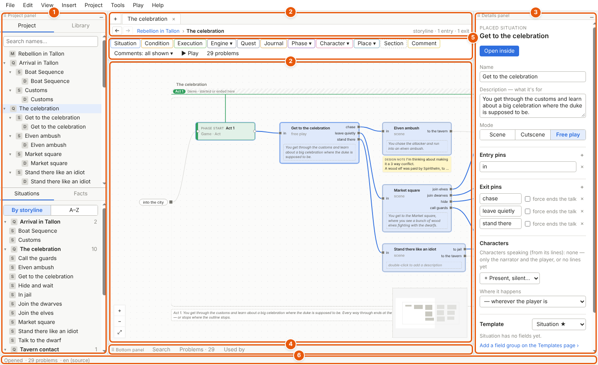
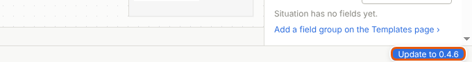
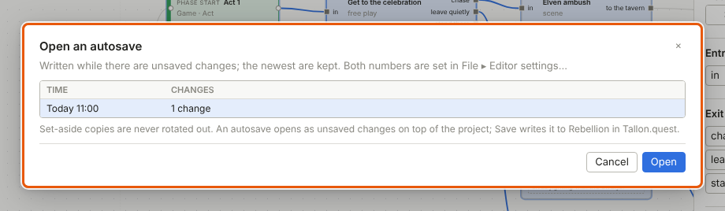
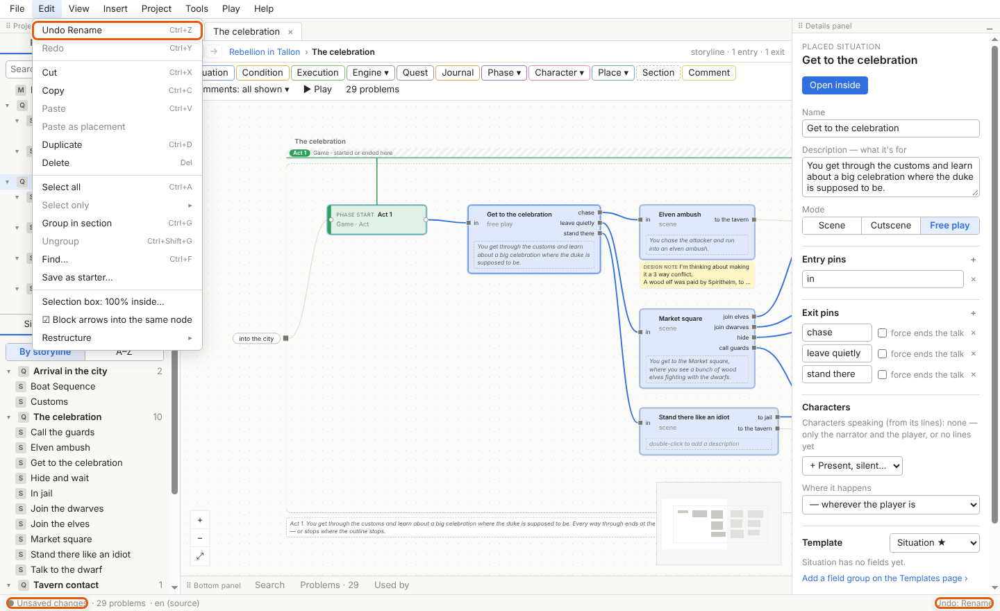

# Getting started

This page gets Storyliner onto your PC and walks you round its window. It also covers the three things that keep your work safe: saving, autosaves and undo.

## Install Storyliner

1. Download the installer from this link. It always gives you the newest version: https://github.com/Tvejzer/Storyliner-releases/releases/latest/download/Storyliner-Setup.exe
2. Run *Storyliner-Setup.exe*.
3. The first time, Windows may say *Windows protected your PC*. The installer isn't signed, so Windows doesn't know it yet. Click *More info*, then *Run anyway*.
4. It asks who it's for — *Only for me* or *Anyone who uses this computer (all users)* — and which folder to install it in. Keep what it suggests, or choose, and finish.
5. Start Storyliner from the desktop shortcut or the Start menu. From now on, double-clicking a *.quest* file in Explorer opens it in Storyliner too.

## Update Storyliner

Storyliner never updates by itself. When it starts, it looks to see whether a newer version is out, and downloads nothing.

1. If there is a newer version, the right end of the status bar shows a button, for example *Update to 0.4.6*.
2. Click it when it suits you. The button says *Downloading 0.4.6…* with how far it has got, then *Installing 0.4.6…*.
3. If you have unsaved changes, Storyliner asks about them, as it does when you close it. *Cancel* stops the update, and the button stays.
4. The new version installs over the old one and starts again on the projects you had open.

To look again by hand, use *Help ▸ Check for updates*. It offers *Update to …* or *Later*, or tells you that you have the newest version. *Help ▸ About Storyliner* says which version you have and what changed in it. *Help ▸ Guide* opens this guide.

## Open a test project

Three of your quests are ready to try things in: *Rebellion in Tallon*, *Kill the Dragon* and *The Fallen Leaves*. They're in the *Projects* folder of your copy of the Storyliner folder. *The Fallen Leaves (imported)*, beside them, is the same chapter brought in by the import kit: see [Importing](importing.md).

1. Choose *File ▸ Open… (Ctrl+O)*.
2. Go into *Projects*, then into a quest's folder, for example *Rebellion in Tallon*.
3. Pick its *.quest* file. The project opens on its first [storyline](glossary.md#s) — one quest, or one thread of the story.

Test projects are rebuilt whenever the file format changes, so what you change in them doesn't last. Try anything you like.

To start your own project, choose *File ▸ New project…*, pick an empty folder and give the project a name. A new project starts with one storyline you can play straight away.

## A tour of the window

The numbers match the picture at the top of this page.

1. **The left panel.** Its top half has *Project* — every storyline and what's placed in it — and *Library* — the characters, locations and other things of the world. Its bottom half has *Situations* — every [situation](glossary.md#s), one scene of the story, in the project — and *Facts* — what the game remembers. Click something to open it. *Ctrl+click* opens it in a new tab.
2. **The tabs and the canvas.** Each storyline, situation, dialogue, character sheet or list you open shows in a tab. The **+** at the far left opens the project map, every storyline at once: see [The project and the project map](project-and-map.md). Under the tabs, the breadcrumb — the path from the project down, such as *Rebellion in Tallon › The celebration* — shows where you are; click a step in it to go back up to it. The ← and → buttons at its left go back and forward, like a browser's. The canvas below is where you build the story out of [nodes](glossary.md#n) joined by arrows: see [Canvases, nodes and wires](canvases.md).
3. **The details panel.** It shows and edits whatever you've selected: a node, an arrow, a placed situation, or the canvas you're in when nothing is selected.
4. **The bottom panel.** It stays a thin strip until you click one of its tabs: *Search*, *Problems* or *Used by*. Then it springs up. The **▾** at its right end folds it again.
5. **The canvas toolbar.** Buttons to add the nodes this canvas can hold, *Comments: all shown ▾*, *▶ Play*, and how many problems the project has. Each node button is outlined in the colour of the node it makes.
6. **The status bar.** Whether you have unsaved changes, when it last autosaved, the number of problems, the project's language, and what *Undo* would take back.

Above it all is the menu bar: *File*, *Edit*, *View*, *Insert*, *Project*, *Tools*, *Play* and *Help*. Point at any button, menu item or field and wait a moment: a tooltip says what it does, and its shortcut if it has one.

You can move the panels. Drag a panel by its title (*Project panel*, *Details panel*, *Bottom panel*) to the left, right or bottom edge to dock it there, or drag its edge to resize it. Click **▁** at the right of the left panel's or the details panel's title to fold it to a strip; click the strip to open it again. *View ▸ Layout* shows or hides each panel and saves layouts by name.

## Save your work

Storyliner never saves by itself. Your project changes on disk only when you save.

1. Choose *File ▸ Save*, or press *Ctrl+S*.
2. The status bar changes from *● Unsaved changes* to *Saved* and the time.

The window's title says *● unsaved changes* too. If you close Storyliner, or open another project, with changes not saved, it asks first: *Save*, *Don't save* or *Cancel*. If you undo back to exactly what you saved, it counts as saved again.

## Autosaves and recovery

Autosaves are a safety net. They are never your project.

- Every 10 minutes, if you have unsaved changes, Storyliner writes a full copy of the project into the *.storyliner/autosave* folder beside it. It keeps the 5 newest. You can change both numbers in *File ▸ Editor settings…*.
- If Storyliner closed unexpectedly, the next time you open the project it asks *Recover unsaved work?* and lists the autosaves with the changes that were never saved. *Restore autosave* opens it; *Open the saved file* opens the project as it was last saved. It also warns you if the saved file has changed since — after a pull from Diversion, say.
- A restored autosave opens as unsaved changes. Nothing is written to your project until you save. A banner says so, with a *Save now* button.

To open any autosave by hand:

1. Choose *File ▸ Open an autosave…*.
2. Click the one you want. Each says when it was made and how many changes it holds.
3. Click *Open*. It opens on top of the project as unsaved changes. *Save* writes it to your project.

## Undo and redo

1. To take back the last thing you did, press *Ctrl+Z*, or choose *Edit ▸ Undo*. The menu item names the step, for example *Undo Rename*. The status bar's right end names it too.
2. To do it again, press *Ctrl+Y*, or choose *Edit ▸ Redo*.

- One step is one finished action: adding or deleting something, drawing an arrow, moving a group of nodes, changing a setting of the project.
- Typing in one box is one step. Leave the box, or pause for about a second, and the step is closed. So one undo takes back the sentence you just wrote, not one letter.
- Undo works while you're typing in the details panel too.
- There is one history for the whole project, shared by every tab. If the step you undo is somewhere else, Storyliner goes there and shows it.
- Saving doesn't clear the history. Closing the project does. Storyliner keeps the last 200 steps; you can change that in *File ▸ Editor settings…*.

## Details and tips

- **The same project open twice** — in two windows, say — is noticed. The second one opens read-only, and the status bar says *read-only*.
- **The file changed on disk** — pulled from Diversion, or edited elsewhere. If you have nothing unsaved, Storyliner reloads it, keeps what you had open, and says so in a banner. Undo starts afresh from the new file. If you do, a banner asks: *Keep mine* or *Take the new file*. The one you don't keep is saved as a copy in *.storyliner/autosave*, so neither is lost.
- **Play your story** at any moment with *Play ▸ Play (F5)*. It opens in a window of its own: see [Play mode and the playable HTML file](play-mode.md).
- **Shortcuts.** *Help ▸ Keyboard shortcuts* lists the main ones. Every one is on [Files, settings and keyboard shortcuts](files-and-settings.md).

---
[Guide home](README.md) · [The project and the project map](project-and-map.md) →

Spec: §3 (releases and updates), §7 (layout), §7.1, §7.2
