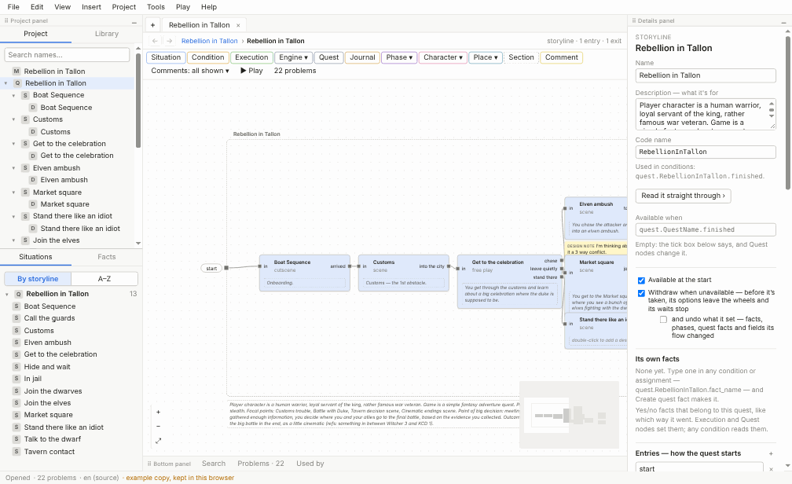
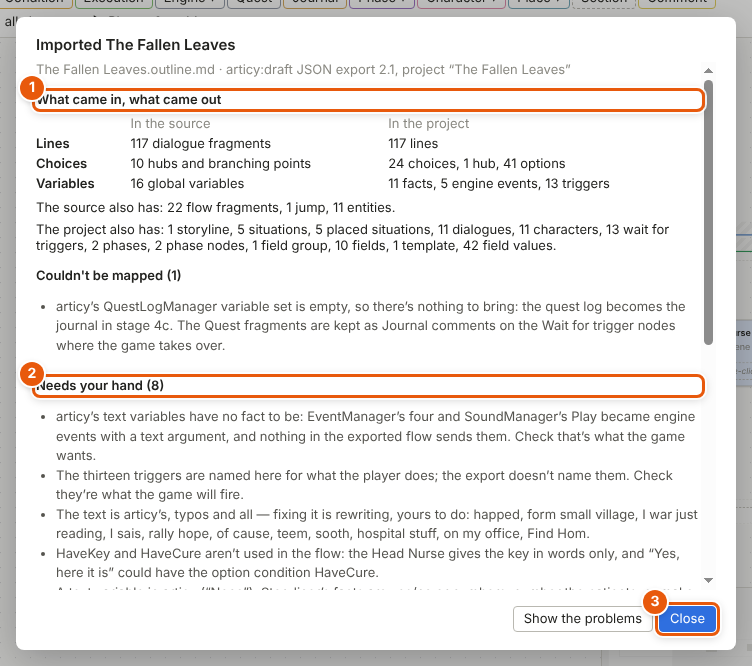

# Importing

Quests you wrote in another tool — articy:draft, Twine, Ink, Yarn Spinner, or plain notes and a Miro board — can come into Storyliner. An AI agent, such as Claude Code, reads the other tool's files and writes an **outline**: a plain text file that lists your characters, facts, [storylines](glossary.md#s), [situations](glossary.md#s) and lines by name. Storyliner turns the outline into a real project, gives everything its [ID](glossary.md#i), lays the canvases out, and tells you what it found.

## Bring a quest in with an AI agent

1. Give the agent your quest's files: an articy:draft JSON export, a Twine story saved as Twee (Twine's plain text file), an Ink or Yarn Spinner file, or your notes.
2. Ask it, in your own words: *Bring this quest into Storyliner. Follow docs/import/README.md.* The kit's guides are written for the agent:
   - [The import kit](../import/README.md) — the workflow, and what to flag instead of guessing
   - [The outline format](../import/outline-format.md) — everything an outline can say
   - [articy:draft](../import/articy.md), [Twine](../import/twine.md), [Ink](../import/ink.md), [Yarn Spinner](../import/yarn.md), [Miro boards, documents and notes](../import/notes.md)
3. The agent writes the outline, checks it with Storyliner's import tool — a small program that comes with Storyliner, which the agent runs for you — until it has no mistakes, and makes the project in a folder of its own.
4. It gives you the **report**. Read its *Needs your hand*: what the agent flagged for you to decide instead of guessing, where the story simply stops, and what's left undecided. That's your list.
5. Open the project in Storyliner — *File ▸ Open…*, then its *.quest* file — and look at what the report points to.

## Bring an outline in yourself

1. Choose *File ▸ Import an outline…* and pick the outline — *Name.outline.md*, say.
2. If a project is open, Storyliner asks where it goes:
   - **Add to this project** adds it to the open project as one undo step.
   - **New project…** asks for an empty folder, makes a new project there, and opens it in place of the open one — asking first, if that one has unsaved changes.
   - **Cancel** brings nothing in.

   With no project open, it asks for an empty folder straight away, and makes a new project there.
3. If the outline has mistakes, a message lists each one with its line, and nothing is imported. Correct them in the outline and import it again.
4. The report opens, over the project, which is already open on the first storyline it brought in. Read the report, then click **Close**.

## Read the report

The report says what the import did:

1. **What came in, what came out** (1): the source's lines, choices and variables against the project's. The numbers should make sense together.
2. **Couldn't be mapped**: what was left out, and why.
3. **Needs your hand** (2): everything the agent flagged, every unfinished bit, every flow that stops, every condition left undecided. What the agent flagged is also a *TODO* [comment](glossary.md#c) on its element in the project.
4. **To copy into resources/ by hand**: files the outline names — pictures, such as portraits — that the editor can't copy for you. (The agent's import tool copies them itself.) This part shows only when there are some.
5. **What the checks found**: whether the project saves back exactly as it was read, and the [validator](glossary.md#v)'s findings on what came in. Click **Show the problems** to see them in the Problems tab (the button shows only when there are some), or **Close** (3).

The report is also written beside the project, in its *import* folder, with a **mapping file** that lists each of the other tool's IDs beside the new one — so existing recordings can be renamed and old notes still found. The report window's last line, *Written beside the project*, names both files.

## Details and tips

- Importing never changes the files it reads.
- The same outline always makes the same new project. Once you've edited the project, it's the source: don't import over it.
- A new project needs an empty folder. Pick one with files in it, and Storyliner says so and makes nothing.
- Added to an open project, the outline uses what's there by name — characters, places, facts, triggers — and its storylines and situations are always new. **Ctrl+Z** takes the whole import back.
- The agent never changes your words: typos come in as written, listed in one flag for you. It doesn't quietly repair your logic either — where a condition is plainly wrong, it does what the story clearly means and flags exactly what it did. Holes stay holes, flagged for you to decide.
- The test project *The Fallen Leaves (imported)*, in the *Projects* folder, came in this way, from *The Fallen Leaves*' articy:draft export. Its *import* folder holds a real report and mapping file to look at.
- After importing, play it to see that it runs: see [Play mode and the playable HTML file](play-mode.md). And check the findings: see [The validator](validator.md).

---
← [The validator](validator.md) · [Guide home](README.md) · [Files, settings and keyboard shortcuts](files-and-settings.md) →

Spec: §14
