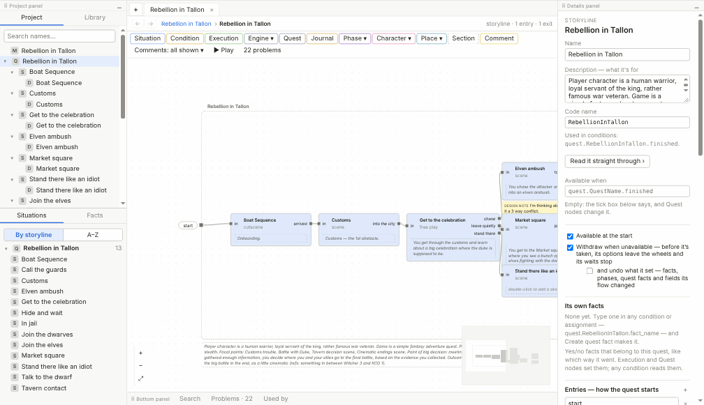
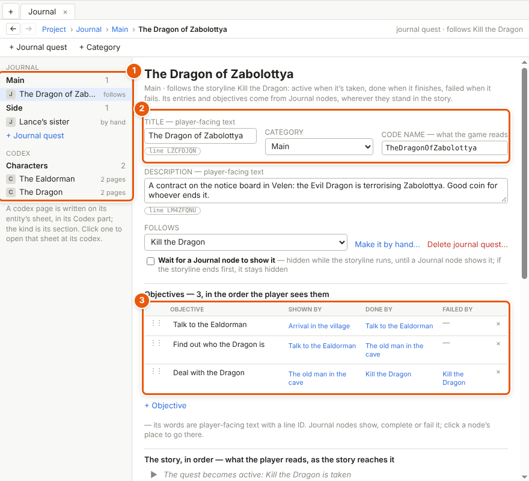
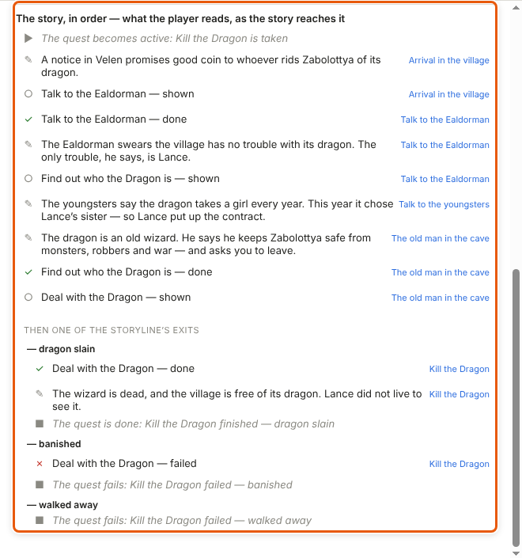
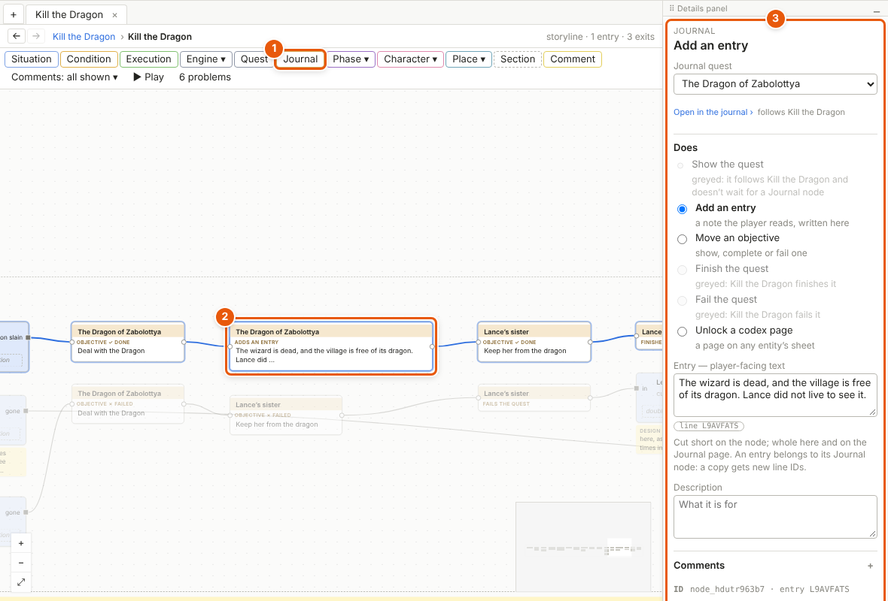
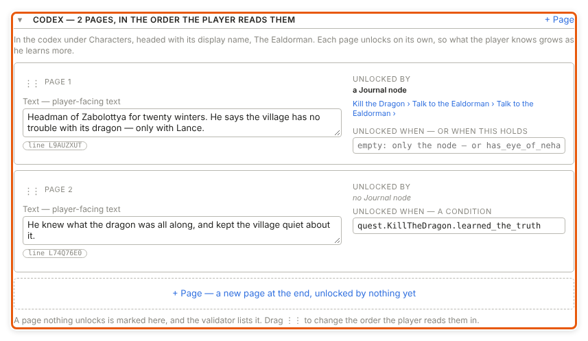
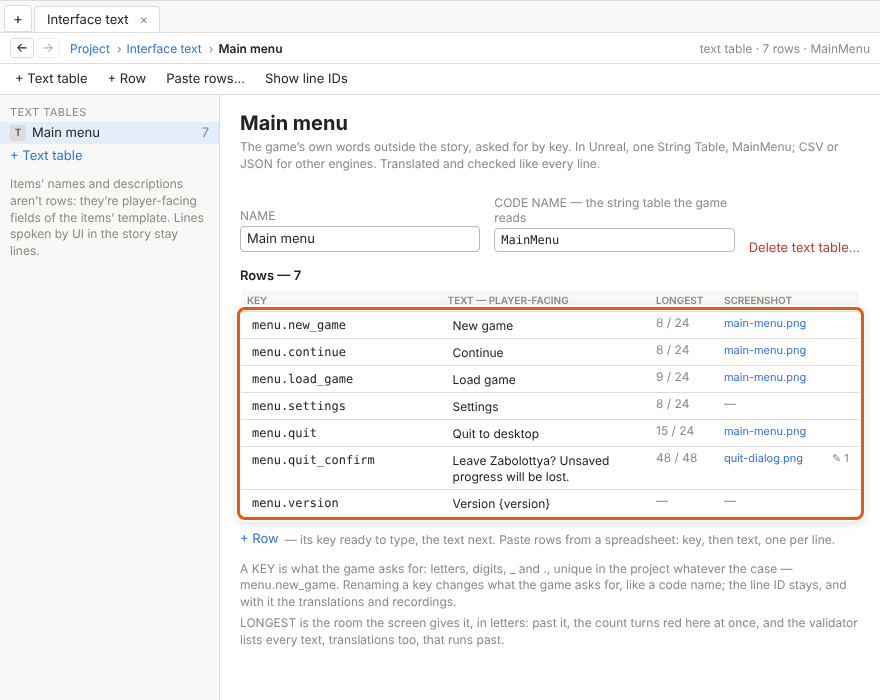

# The journal, the codex and interface text

The **journal** is what the player reads about his quests; the **codex**, what he has learned about the world; **interface text**, the game's words outside the story — menus, the HUD, tutorials. You write all three in Storyliner, so every word of the game is in one place and checked the same way — ready to be translated the same way once translations come — and the journal and codex follow the story as it's played.

## Add a storyline to the journal

1. In the Project tab, right-click a storyline ▸ *Add to journal* — or right-click its box on the project map, or click *+ Add to journal* in the storyline's details.
2. The new **journal quest** opens on the Journal page. Its title starts as the storyline's name; change it to what the player should read.
3. It **follows** its storyline: active when the quest is taken, done when it finishes, failed when it fails.
4. Tick *Wait for a Journal node to show it* for a quest that starts quietly, before the player knows of it.
5. Click *+ Objective* and type the tasks it lists — each an **objective**, which the story shows, completes or fails.

A journal quest is separate from its storyline, because what the player sees isn't always how the story is built: one storyline can feed two journal quests, and two storylines one. *+ Journal quest* on the Journal page makes one **by hand**, with nothing behind it: only Journal nodes change it. *Make it by hand…* turns a following quest into one.

## Read and edit the journal on its page

1. Choose *Project ▸ Journal…*. It opens as a tab.
2. On the left (**1**) is the list: the journal quests by category, each marked *follows* or *by hand*, then the codex by section. *+ Category*, on the page's toolbar, adds a heading the player reads, like *Contracts*: name it and click *Create*. Double-click a category to rename it; drag a quest onto another category to move it.
3. Click a quest. At the top (**2**) are its title, its *Category* and its [code name](glossary.md#c), the name the game knows it by. Its title and description are **player-facing text**: words the player reads, each with its **line ID** — a permanent code of its own, so its translations and recordings can follow it once those come.
4. Below are its objectives (**3**), in the order the player sees them, each with the Journal nodes that show, complete or fail it. Drag ⋮⋮ to reorder; click a node's place to go there.
5. Further down, *The story, in order* shows every entry and objective change as the story reaches them, each with where it happens. Where the story forks for good, it follows each of the storyline's exits in turn:

Click a step to see it in the details; double-click an entry to edit its words there; click where it happens to go there.

## Write to the journal from the story

The **Journal node** puts the journal into the flow, where things happen.

1. On the canvas toolbar, click *Journal* (**1**), or choose *Insert ▸ Journal*. A new one starts as *Add an entry*.
2. Select the node (**2**). In its details (**3**), pick the *Journal quest*.
3. Under *Does*, pick the one thing it does: *Show the quest*, *Add an entry*, *Move an objective* (show, complete or fail one), *Finish the quest*, *Fail the quest*, or *Unlock a codex page*.
4. For an entry, type its words — a note the player reads, *"The wizard is dead…"*. For an objective, pick it and what it moves to: *shown*, *done* or *failed*; *New objective…* makes one from here. For a codex page, pick the *Entity* the page is written on — a character, a place, anything in the Library — and the *Page*; no journal quest is needed.

On a quest that follows its storyline, *Finish the quest* and *Fail the quest* are greyed — the storyline decides — and so is *Show the quest*, unless the quest waits for a Journal node. *Open in the journal ›* goes to the quest's page.

## Write codex pages

The codex is pages of text on any **entity** — a character, a place, an item, a creature: anything in the Library. The entity's display name is the page's heading, and its kind is the codex's section.

1. Open the entity's sheet and go to its *Codex* part. Once an entity has pages, it's also listed under *Codex* on the Journal page: click it there to open its sheet at its codex.
2. Click *+ Page* and type what the player reads.
3. Unlock it: with a Journal node set to *Unlock a codex page*, or with a condition under *Unlocked when* — with both, whichever comes first. A page stays unlocked once it is, so what the player knows grows as he learns more.
4. Drag ⋮⋮ to change the order the player reads them in. A page nothing unlocks yet is marked *nothing unlocks this page yet*.

## Write interface text

1. Choose *Project ▸ Interface text…*. It opens as a tab.
2. Click *+ Text table*: a table called *New text table* opens. Type its *Name* over that — *Main menu*, *HUD*, *Tutorials*. Once the Unreal plugin comes, each table will be one String Table there.
3. Click *+ Row*. Type its **key** — the name the game asks for, *menu.new_game*: letters, digits, _ and ., different from every other key in the project, capitals or not — then its text. *Enter* in the last row's text adds another row.
4. Click the row and, in the details, set *Longest*: the room the screen gives it, in letters. Past it, the count in the *Longest* column turns red.
5. *Paste rows…* takes rows from a spreadsheet: the key, then the text, one row per line. Rows that can't come in — a key already taken, say — are listed first, each with why. Rows pasted straight onto the table come in the same way.

*Show line IDs* adds a column of each row's line ID. Renaming a key changes what the game asks for; the line ID stays — and with it, once they come, the row's translations and recordings.

## Details and tips

- **All journal, codex and interface text is player-facing**: each has a line ID, ready for translations and recordings when they come.
- **Entries show in the order the player reached them** — in the game, and in play mode. An entry reached again isn't shown twice.
- **Deleting** a journal quest, an objective or a codex page lists the Journal nodes that name it first; they're left unfinished, and the *Problems* tab of the bottom panel lists them.
- **Play mode** shows the journal and the codex as they stand, in the play window's *Journal & notes* tab, and journal notes in the story where they happen (see [Play mode and the playable HTML file](play-mode.md)).
- Items' names and descriptions need no rows: they're player-facing fields of the items' template (see [Templates and fields](templates.md)). Lines the *UI* speaker says inside the story — a chapter title, a note on screen — stay lines.

---
← [Templates and fields](templates.md) · [Guide home](README.md) · [Reading tools](reading-tools.md) →

Spec: §4.22, §4.23
