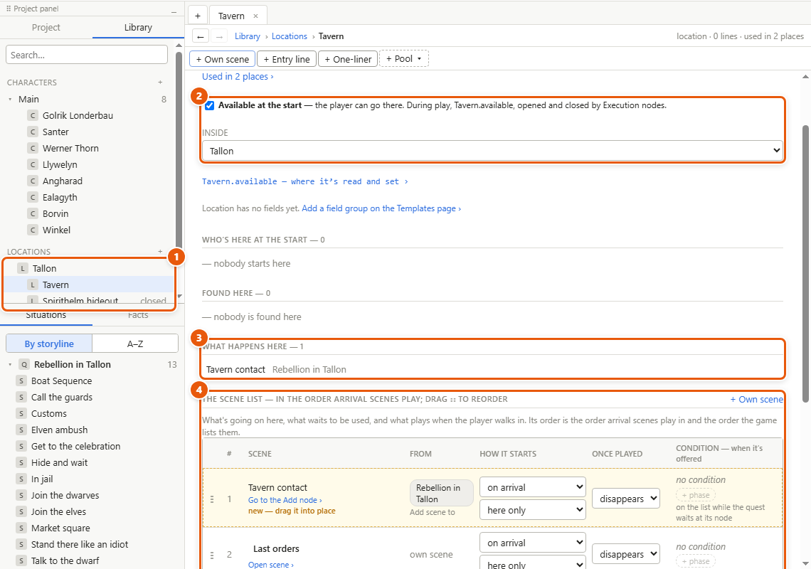
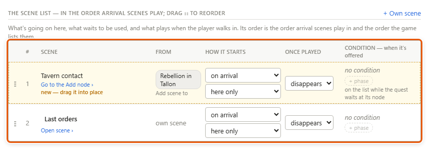
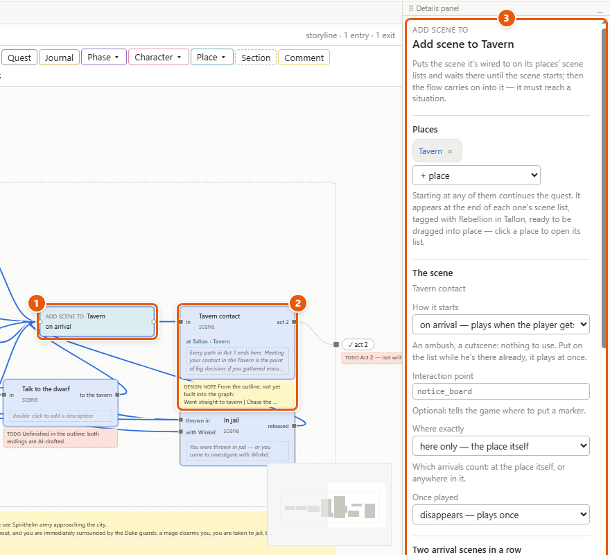

# Locations and scene lists

Locations are the places of your game — a city, a tavern inside it, a hideout. Each one says whether the player can go there, which place it's inside, what happens there, and, in its **scene list**, what's going on there, what waits to be used and what plays when the player walks in. The game reads that list — and play mode, standing in for the game, does too — to show and hide scenes, put markers and people where they belong, and play a cutscene as the player arrives.

*In the picture: **1** the places in the Library, the Tavern inside Tallon, the Spirithelm hideout closed; **2** whether the player can go there at the start, and the place it's inside; **3** what happens here; **4** its scene list. (Rebellion in Tallon has no places of its own: these were added for the picture, as the steps below make them.)*

## Make places, one inside another

1. Choose *Project ▸ New location…* (or *+* beside *Locations* in the [Library](glossary.md#l) tab), type its name — *Tallon* — and click *Create*. Its sheet opens in a tab.
2. Make another — *Tavern* — and drag it onto *Tallon* in the Library: it goes inside. Or pick *Tallon* under *Inside* on the Tavern's sheet. To take a place out of any, drag it onto the *Locations* heading.
3. On the sheet of a place the player can't go to yet — the hideout — untick *Available at the start*. The Library marks it *closed*. During play an [Execution node](glossary.md#e) opens it: *SpirithelmHideout.available = true*.
4. In a [condition](glossary.md#c), *player.location == Tallon* holds only in Tallon itself; *player.location in Tallon* holds in Tallon and in every place inside it — the Tavern too.

## Say where things happen

1. Open the storyline's canvas.
2. Drag a place from the Library onto a [situation](glossary.md#s)'s box — or select the situation and pick the place under *Where it happens* in its details. The box now reads *at Tallon › Tavern*.
3. The place's sheet lists the situation under *What happens here*, with its storylines, and the storyline's details list its places under *Its places — from its situations*.

A situation's place is a description: it makes nothing wait by itself. To make a scene wait for the player at a place, put it on the place's scene list (below).

## Say where people are

1. On a character's sheet, under *Found in*, pick each place he can be found in from *+ Add location*. Those places' lines show further down his sheet, ready to drag into his [pools](glossary.md#p); a place's line plays only while he's there.
2. Under *Where he starts*, pick the one place he's in when the game begins. During play it changes: an Execution node with *Santer.location = SpirithelmHideout* moves him, and the game is told, so it can move the NPC.
3. For the player, choose *File ▸ Project settings…* and pick a place under *The player starts in*: that's where play begins. Left empty, the player is nowhere until the game says where he is or the story moves him.

## The scene list

A place's scene list is one list, in order — the order arrival scenes play in and the order the game lists them. It holds:

- **its own scenes** — small pieces of story of the place's own, on the list from the start of the game. *+ Own scene* makes one at the end of the list; *Open scene ›* opens it on its own canvas to write what it plays;
- **scenes quests add** with an [*Add scene to*](glossary.md#a) node — on the list from the moment the quest's flow (the story moving along its arrows) reaches the node until the scene has played and gone. As soon as a node names the place, its scene appears at the end of the list, marked *new — drag it into place*; *Go to the Add node ›* opens the node.

For each scene, set:

1. **How it starts** — *on arrival* (plays when the player gets there: an ambush, a cutscene), *when used* (waits until the player uses its interaction point: picks the lock, reads the notice board), or *already there* (going on quietly from the moment it's on the list).
2. **Where exactly** — *here only*, the place itself, or *here and inside*, anywhere in it.
3. **Once played** — it *disappears*, *stays* (plays again each time), or *greys out* (stays, shown as used).
4. **Its condition** — when it's offered — and the *only during* / *not during* chips (*+ phase* — see [Phases](phases.md)).

Click a row to see all its settings in the details panel — its interaction point and prompt too. Drag a row by ⋮⋮ to change the order.

## Put a scene on a place from a quest

1. On the storyline's canvas, right-click the placed situation that is the scene (**2**) ▸ *Add scene to… in front*. The new node (**1**) takes the arrows that went into the situation, and the situation's place.
   Or click *Place ▾ ▸ Add scene to* on the toolbar and wire it in front of the situation: it takes the situation's place too, and you can add others under *Places* with *+ place* in its details.
2. In the details (**3**), set *How it starts*, its *Interaction point* — the code name the level designer gives a thing in the level, like *notice_board* (see [interaction point](glossary.md#i)) — *Where exactly* and *Once played*. A scene set to *when used* or *already there* also gets a **prompt**: the words the game shows at that point, *Pick the lock*.
3. When the quest's flow reaches the node, the scene is on the list and the flow waits there; when the scene starts, the flow carries on into it.
4. To take scenes off a list, use *Place ▾ ▸ Remove scene from*: pick the *Place*, then tick the scenes it takes off.

## Details and tips

- **A quest's state never adds or removes a scene by itself.** A scene goes when it has played (*disappears*), by its condition, or by a *Remove scene from* node. The exception: a storyline with *Withdraw when unavailable* ticked takes its scenes off when it's withdrawn.
- **A *Remove scene from* node reached before its quest's scene was added** does nothing — unless *Block adding this scene* is ticked in its details: then that scene is never added.
- **People stay on their own [wheels](glossary.md#w).** Talking to someone is on his wheel, never on a scene list. When a scene's *Add dialogue to* node puts an option on Santer's wheel, both show the link: the scene's row names *Santer: About the job*, and Santer's wheel names the scene and its place.
- **Arriving, and places inside places.** Coming from outside Tallon straight into the Tavern, the player arrives in Tallon and then in the Tavern: Tallon's *here and inside* arrival scenes play first, then the Tavern's.
- **Two arrival scenes in a row.** Two scenes waiting at one arrival play back to back only if the first has *Let the next one play after it* ticked and the second *May play right after another* — both are ticked to begin with, in each *on arrival* scene's details. Otherwise the second waits for the player's next arrival there.
- **In play mode**, the play window's game panel has a *Go to…* list that moves the player, and *Scenes here* shows the place's scene list as the game reads it (see [Play mode and the playable HTML file](play-mode.md)).
- **What changes during play.** A place's *available* and a character's *location* each have a view of where they're read and where they're set: the link under them on the sheet, like *Tavern.available — where it’s read and set ›*. The player's place has one too, in *File ▸ Project settings…*.

---
← [Phases](phases.md) · [Guide home](README.md) · [Templates and fields](templates.md) →

Spec: §4.25, §4.15
