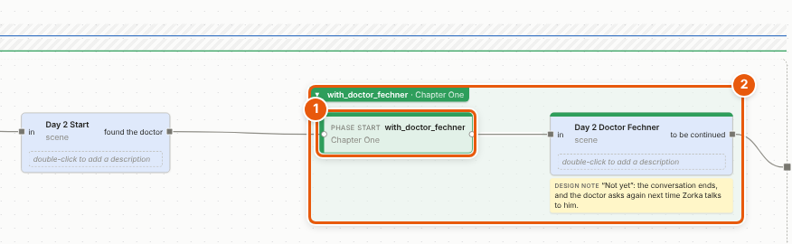
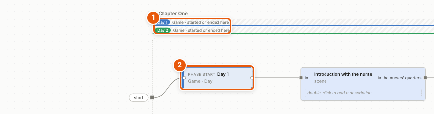
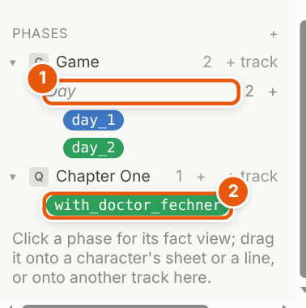
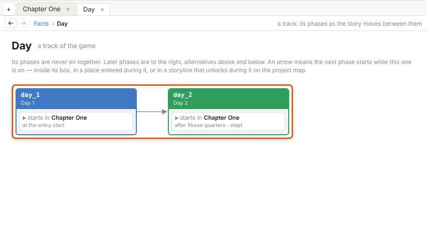
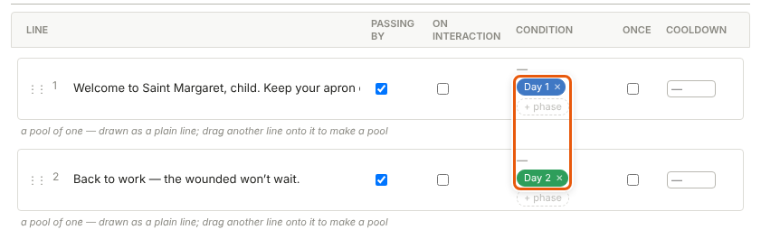
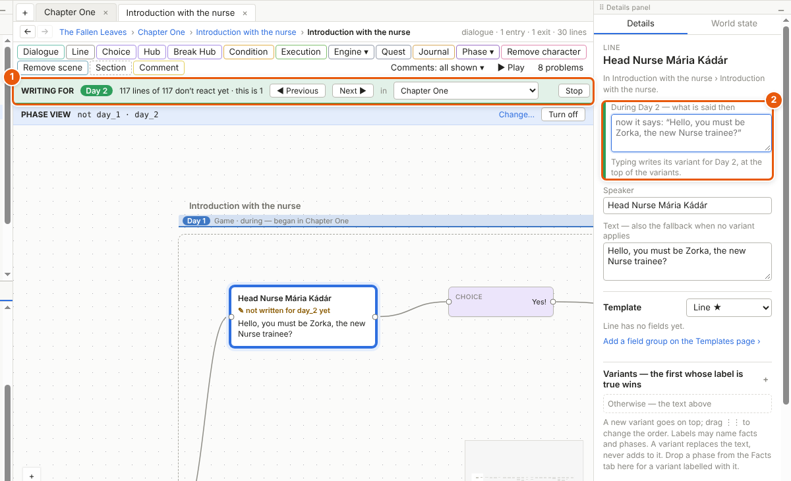
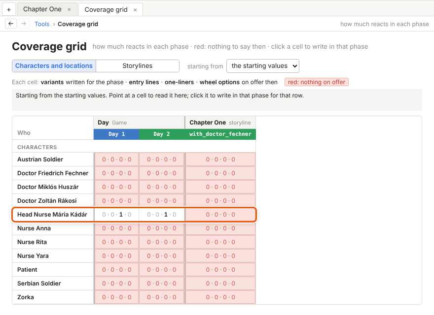
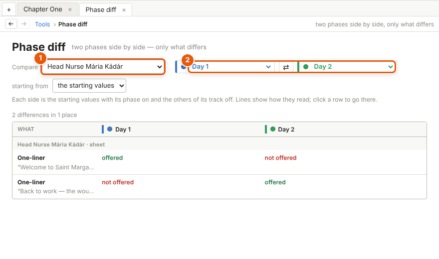

# Phases

A phase is a period of your story — *the war*, *winter*, *Day 2*. Nodes on the canvas start and end it, a box in its colour shows what happens during it, and lines, options and conditions can ask whether it's on, as they ask any yes/no [fact](glossary.md#f). The phase tools then let you write and check the game one phase at a time.

*In the picture: **1** a Phase start node, **2** the box of the phase it starts — everything the flow reaches from there until the canvas's exit. (This phase, with_doctor_fechner, was added to The Fallen Leaves for the picture.)*

## Make a phase and start it

1. Open the canvas where the phase begins — a storyline, a situation or a dialogue.
2. On the toolbar, click *Phase ▾* and pick *Phase start* (or use *Insert ▸ Phase start*).
3. With the new node selected, type the new phase's code name in the details, in the box *new phase: its code name* — *the_war* — and press Enter, or click *Create phase*. The phase belongs to the canvas you're on, unless you pick another level beside the name. To start a phase that already exists, pick it from the list above instead.
4. Wire the node into the flow — the arrows the story moves along — where the phase begins. Its box appears around everything the flow reaches after it.
5. Where the phase ends, add *Phase ▾ ▸ Phase end* and pick the phase. Starting another phase of the same track ends it too.

A phase can have as many starts and ends as you need, in different places: the war breaks out whichever way the player goes.

## Levels and tracks

- **A level** is what a phase belongs to: the **game**, a **storyline**, a **situation** or a **dialogue**. Its starts and ends must be at that level or inside it. Checking it works everywhere.
- A game phase lasts until something ends it. A storyline's, situation's or dialogue's phase also ends when the flow leaves that canvas through one of its exits — or, for a dialogue, when the talk ends.
- **A track** is a row of phases that are never on together: starting one ends whichever of its track was on. Each level starts with one track. Add another where periods overlap — *Acts*, *Season* and *War* can run side by side.
- A track isn't a straight line: after *Act one* the story can go to *Rebels win* or *King wins*, and come together again.

## Boxes, strips and bands

1. On a canvas, **its own phases are boxes**. A node inside a box has a band across its top in the phase's colour.
2. **Phases from above** — the game's, or an outer storyline's — are **strips along the top of the [frame](glossary.md#f)** (**1** in the picture). A line runs up from the node that starts one (**2**): solid where it starts, dashed where it ends.
3. On the project map, game phases are **bands** across the storylines (see [The project and the project map](project-and-map.md)).

Moving a box: drag its bar, and its nodes move with it. Right-click the bar to *Fold* the box into its bar, open its [*Fact view*](glossary.md#f), see what uses it (*Used by*), *Write for this phase*, or *Hide this track*. *View ▸ Phase tracks* shows or hides whole tracks.

Putting a node in or out of a box changes only the layout, never the flow:

- A node you drag stays in its box, and the box follows it. Hold **Alt** while you drag to drop it outside.
- Right-click a node ▸ *Remove from* and the phase's name puts it just outside the box.
- A node drawn where it doesn't play is warned about until you right-click it ▸ *Back where the flow puts it*.
- Click a box's bar to show handles on its edges; drag them to resize it, as you would a [section](glossary.md#s).

## The Phases part of the Facts tab

1. In the left panel, open the *Facts* tab and scroll down to *Phases*: the game first, then each storyline, its situations and dialogues, each with its phases by track, in their colours.
2. Click a track's name (**1**) to open the track's page. Double-click it to rename it. A level's first track has no name, and so no row of its own, until you give it one: right-click the level ▸ *Its track’s page*, or *Name its first track…*.
3. Click a phase (**2**) to open its fact view: every start and end, and everything that checks it. Its details hold its colour, track, level and, for a game phase, *Started by the game*.
4. *+* beside a level or a track makes a new phase there; *+ track* adds a track to that level.
5. Drag a phase onto a character's sheet, a line, or another track.

## A track's page

1. Click a track's name in the Facts tab. Its page opens in a tab.
2. Its phases are drawn as the story moves between them: later ones to the right, alternatives above and below. An arrow means the next phase starts while this one is on.
3. Each card lists the phase's starts and ends: click one to go to that node. Double-click a card for the phase's fact view.

## Only during and not during

On a [sheet](glossary.md#s), many things can be **only during** some phases and **not during** others: a character's own dialogues, the options *Add dialogue to* nodes put on his wheel, his [entry lines](glossary.md#e), [one-liners](glossary.md#o) and [pools](glossary.md#p), and a location's scenes.

1. Open the character's or location's sheet.
2. Find the item, and click *+ phase* beside its condition.
3. Pick a phase from the short list, then *Only during* or *Not during*, followed by its name. Or drag a phase from the Facts tab onto the item.
4. Click × on a chip to take it off.

The item is offered only while one of its *only during* phases is on (if it has any) and none of its *not during* ones — and its condition holds. The chips sit beside the condition and are never written into it.

Drag a phase onto a line, or onto its [variants](glossary.md#v), to add a variant labelled with that phase, ready for its words.

## The phase view

1. Choose *View ▸ Phase view*. A *PHASE VIEW* strip shows over the canvas, and the details panel opens on its *World state* tab.
2. Pick which phase is on in each track — and, if you like, facts, numbers and quest states.
3. Every line reads as it would then. Options, outputs and branches that this world rules out fade, and so does anything reached only through them.
4. To keep this world for the whole team, click *Save as…* under *Named world states* — see [Facts, conditions and world states](facts-and-conditions.md). You can pick it again here, in the coverage grid, in the phase diff, and to start [play mode](glossary.md#p) in (*Play ▸ World state…*).
5. Click *Turn off* on the strip, or choose *View ▸ Phase view* again.

The phase view is a way of looking: it changes nothing in the project.

## Write for a phase

1. Open where you want to write — a storyline, a situation, a character or a location.
2. Choose *View ▸ Write for a phase*, then the track, then the phase — here *Day — Game ▸ day_2*. Or right-click a phase box's bar ▸ *Write for this phase*. The phase view comes on, with that phase on.
3. The strip (**1**) counts the lines that don't react to the phase yet. *Next ▶* opens the next one, in story order, with the cursor in it. *◀ Previous* goes back. The list after *in* changes where to look: the whole game, a storyline, a situation, a character or a location.
4. Type in the line's details, in the box at the top — here *During Day 2 — what is said then* (**2**). What you type becomes the line's variant for that phase, at the top of its variants.
5. Click *Stop* when you're done.

A line *reacts* to a phase when one of its variants' labels names the phase, or when its *Phaseless* box is ticked (it always says its text). Nothing changes until you type.

## The coverage grid

1. Choose *Tools ▸ Coverage grid*.
2. Pick *Characters and locations* or *Storylines* for the rows. The phases are the columns, by track.
3. Each cell counts what reacts in that phase: variants written for it · entry lines · one-liners · wheel options on offer. Red means nothing is on offer then.
4. *starting from* picks a named world state instead of the starting values.
5. Click a cell to write in that phase for that row.

In The Fallen Leaves everyone speaks inside situations, so the grid is all red but for the Head Nurse's two days: her one-liners, one for each day, were added for the picture.

## The phase diff

1. Choose *Tools ▸ Phase diff*.
2. Pick what to compare (**1**): a storyline, a situation or a character.
3. Pick the two phases (**2**); ⇄ swaps them. *starting from* picks a named world state instead of the starting values.
4. Only what differs is listed. Click a row to go there.

## Details and tips

- **Only phase nodes start and end phases**, never Execution nodes, so the boxes never lie. The one exception is a game phase with *Started by the game* ticked — night, or a season the game keeps itself.
- A **Phase switch** checks a phase and leaves by *Is current* or *Not current*. Give it more phases and it's a **Multi phase switch**: the first phase in its list that's on decides, and *Other* is for none.
- Starting a phase that's on, or ending one that's off, does nothing. Play mode notes it.
- A storyline's phases say *where the quest is* while it runs, and end with it. What must last after the quest is a [quest fact](glossary.md#q) or a game phase.
- A game phase starting or ending will also tell the game, so it can change the music or the weather. That comes with the Unreal plugin, in a later stage.

---
← [Quests, events and triggers](quests-and-events.md) · [Guide home](README.md) · [Locations and scene lists](locations.md) →

Spec: §4.24, §7.9, §7.11
