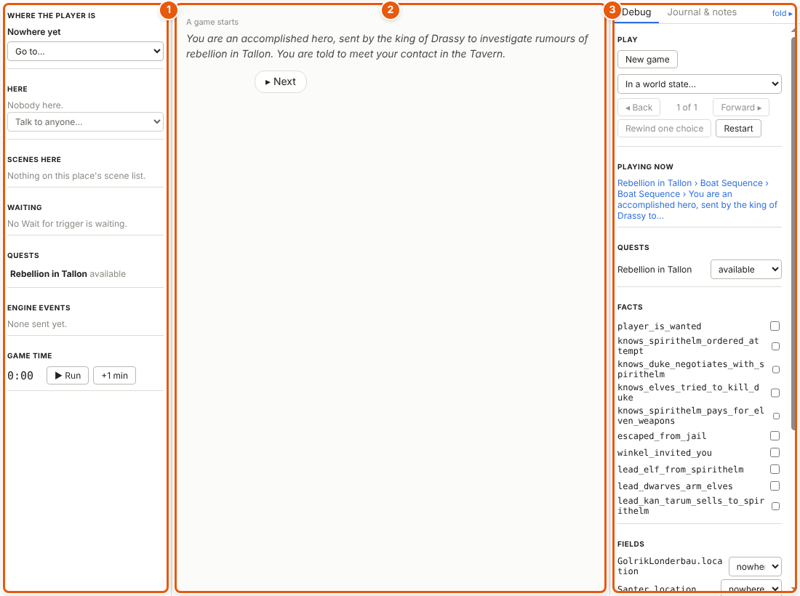
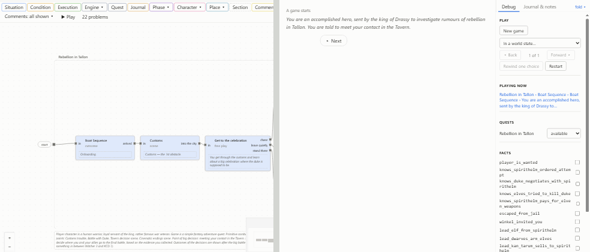
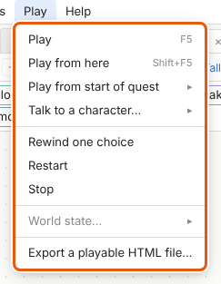
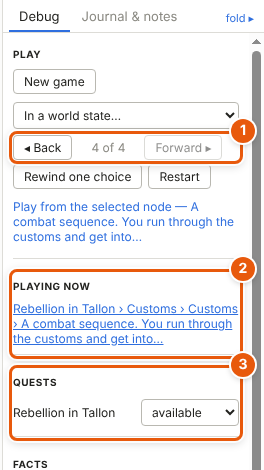
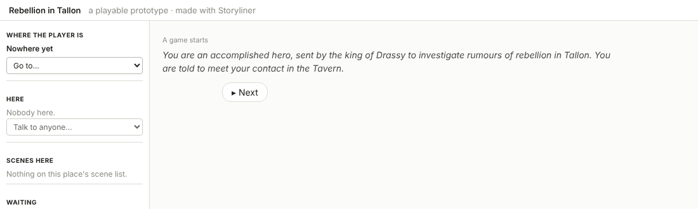
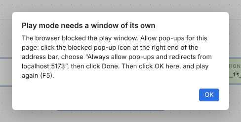

# Play mode and the playable HTML file

Play mode lets you walk your own quest, like playing a Twine story, with the real logic running: [conditions](glossary.md#c) are checked, [facts](glossary.md#f) change, [quests](glossary.md#q) start and end. It opens in a window of its own, so the game and the canvas can sit side by side. When you want to show your work to someone, export the same screen as one HTML file that opens in any browser.

## Play the game from its start

1. Press **F5**, or choose *Play ▸ Play (F5)*, or click **▶ Play** on the canvas toolbar.
2. The play window opens. The first time, it opens beside the editor's window; after that, where you left it, at the size you left it.
3. The first time you play a project, a game starts from the beginning. After that, **F5** picks up your run where you left it: to start from the beginning again, click **New game** at the top of the debug panel (3).
4. Read the first lines in the middle, the **story** (2). Click **▸ Next**, or press **Space** or **Enter**, to show the next line. A line with [timing](glossary.md#t) goes on by itself.
5. When there's a choice, its options appear below **▸ Next**. Click one, as the player would.
6. Keep the editor open beside it. Edit a line, a condition or a fact there, and the game uses the change from its next step: a run always reads the project as it is.

## Find where the story is on the canvas

1. Look at **Playing now** in the debug panel, on the right of the play window.
2. Click it. The editor's window comes to the front with that node selected on its canvas. In the browser, the editor's window may stay behind: then a note in the play window says so, and you switch to it yourself.

## Play from a node, a quest's start, or a character

- **From a node:** select it on a [canvas](glossary.md#c), then press **Shift+F5**, or choose *Play ▸ Play from here (Shift+F5)*. It plays in the [placement](glossary.md#p) you opened that canvas through (its [breadcrumb](glossary.md#b)), with its storyline taken. With the play window open, **Play from the selected node — …** in the debug panel does the same.
- **From a quest's start:** choose *Play ▸ Play from start of quest*, the quest, then one of its [entry pins](glossary.md#e). The quest is taken, and play starts from what that entry leads to.
- **Talking to a character:** choose *Play ▸ Talk to a character…* and pick him, or click **▶ Play** on his sheet. You talk as the player would: an option that plays at once, or an [entry line](glossary.md#e), then his [wheel](glossary.md#w). A [generic character](glossary.md#g) — the guard, the trader — is one sheet for many NPCs (non-player characters: every guard in town), so Storyliner asks which one you mean: type a name or a number. Each NPC remembers his own conversations.
- **In a world state:** choose *Play ▸ World state…* and pick one, or use *In a world state…* in the debug panel. See [Facts, conditions and world states](facts-and-conditions.md).

Each of these opens the play window, or brings it to the front, and starts there.

## Act as the game would

The **game panel**, on the left (1), does what the game would do:

1. **Where the player is:** pick a place under *Go to…* to move there. Its arrival scenes play.
2. **Here:** the characters here. Click **Talk** beside one, or pick a [one-liner](glossary.md#o) under *One-liner…*. For a generic character, pick which of his NPCs first, in the list beside his name. *Talk to anyone…* reaches any character, wherever he is.
3. **Scenes here:** the place's [scene list](glossary.md#s) as the game reads it. A *when used* scene is a button: click it to use it.
4. **Waiting:** every [*Wait for trigger*](glossary.md#w) node that's waiting. Set the facts the game would write first, then click its **Fire …** button, which names the [trigger](glossary.md#t), to fire it.
5. **Quests:** the quests available or taken, and what each is waiting for. Click one to see only its lines in the story; click it again for everything.
6. **Engine events:** the [engine events](glossary.md#e) sent, logged but not run.
7. **Game time:** a clock for cooldowns — the time a one-liner must wait before it can play again. It runs while you play. **▶ Run** or **⏸ Pause** it; **+1 min** moves it on.

## Change anything, and step back

The **debug panel** (3 in the first picture) changes anything at any moment, and steps through what was done.

1. Click **◂ Back** to step back one action, **Forward ▸** to step forward again (1). The world goes back and forward with it. In the play window, **Alt+←** and **Alt+→** do the same.
2. Click **Rewind one choice** to go back to just before the last option picked.
3. Click **Restart** to begin again from where this run began. Once anything has been played, it asks first.
4. Set any fact, [phase](glossary.md#p), quest state, [reputation](glossary.md#r) or [field](glossary.md#f) that changes during play. A quest's state set here does what that change does in the story (3).
5. Read the **Log** at the bottom: what the run noted. Errors are in red. Click a row that names a node to see that node in the editor.

Click **Journal & notes**, at the top of the side panel, for the journal and the codex as the player sees them, and the descriptions and comments of what's playing. Click **fold ▸** to fold the side panel away and give the story more room; **Debug · Journal & notes ◂** brings it back.

## Stop playing

1. Close the play window, or choose *Play ▸ Stop*.
2. The run is kept. Press **F5** later and it picks up where you were, even after you close Storyliner.

## Show your work: the playable HTML file

1. Choose *File ▸ Export a playable HTML file…* (it's in the *Play* menu too).
2. In the browser, the file downloads. In the desktop app, a save dialog asks where; it suggests the project's folder.
3. A message says where it went. Send that one file to anyone.
4. They open it in any browser, with nothing installed and no internet. It's the same play screen, with the side panel folded away to start with, and a line at the top: *a playable prototype · made with Storyliner*.

The file holds the project as it is in the editor at that moment, unsaved changes too. It keeps its run in that browser, so closing it loses nothing; a browser that won't keep it gets a note at the top saying so, and the file still plays.

## Keys in the play window

| Key | Does |
|---|---|
| **Space**, **Enter** | The next line, or go on |
| **Alt+←**, **Alt+→** | Back and forward one action |
| Mouse back and forward buttons | Back and forward one action |
| **F5** | Play: picks up the run, or starts a game |
| **Shift+F5** | Play from the node selected in the editor |
| **Ctrl+S** | Save the project |

## If the browser blocks the play window

In the browser, the play window is a pop-up, and a browser may block it. Then Storyliner tells you how to allow it:

1. Click the blocked pop-up icon at the right end of the address bar.
2. Choose *Always allow pop-ups and redirects from* this page, then **Done**.
3. Click **OK** in Storyliner's message, then press **F5** again.

The desktop app never blocks it.

## Details and tips

- There is one play window for each project window. It closes when the editor's window closes.
- Questions play mode asks — *Restart?*, *Talk to which Guard?* — show in the window you're using.
- Lines just played go on by themselves when they have timing. After **◂ Back**, **Forward ▸**, **Rewind one choice** or a run picked up, nothing goes on by itself; **▸ Next** still does.
- Options just put on offer take clicks a moment after they appear, so a click meant for **▸ Next** never picks one by accident.
- Random picks — which line a random [pool](glossary.md#p) plays — come out differently in each new game and after each **Restart**. Within one run they stay the same, so stepping back and forward plays the same lines.
- The run is yours: it's kept beside the project, in its *.storyliner* folder, never in the project file.
- Languages and voices in play mode come in a later version.

---
← [Reading tools](reading-tools.md) · [Guide home](README.md) · [The validator](validator.md) →

Spec: §8, §5.10
