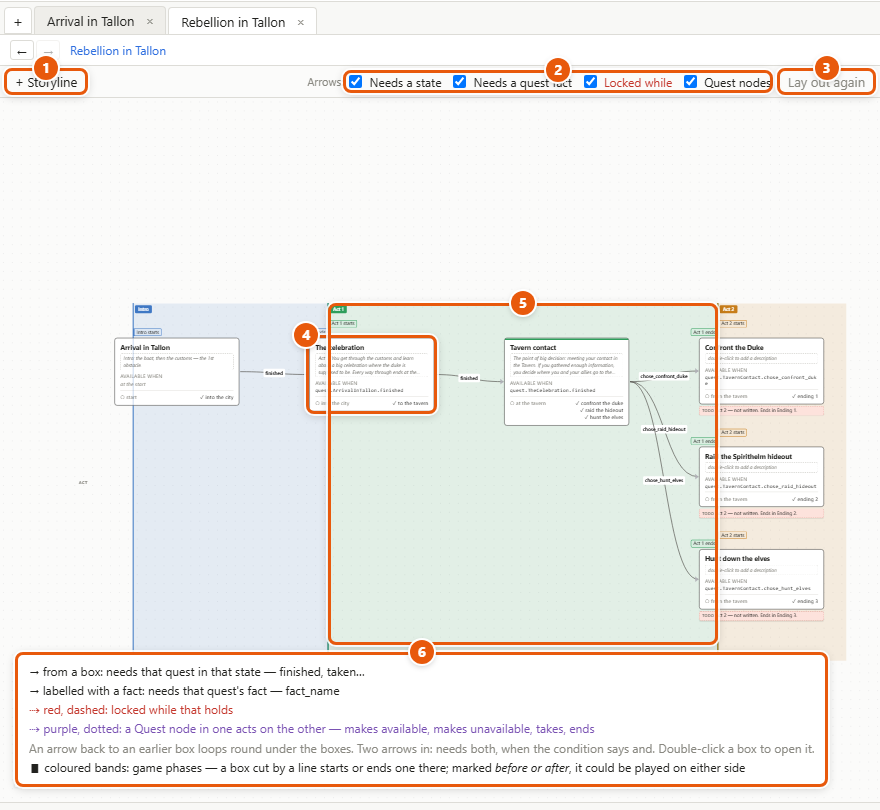
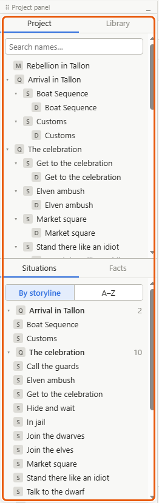
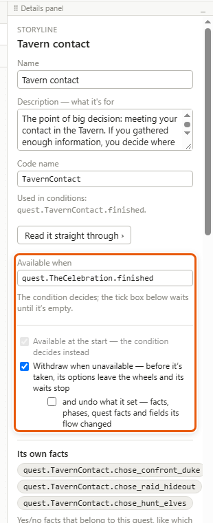

# The project and the project map

A project is your whole game's story in one file: every quest, the situations they're made of, the characters, places and facts. The project map is its top level: every quest at once, in the order they unlock, so you can see how they hang together.

## What a project holds

- **Storylines.** A storyline is a quest. Its canvas holds the situations it's made of, wired in the order they play, between its entries (the ways it can start) and its outcomes (the ways it can end, each marked *✓ finished* or *✗ failed*).
- **Situations.** A situation is one scene of the story — *Market square*, *Talk to the dwarf*. It holds the dialogues and the logic inside it. One situation can be placed in several storylines; each place it's put is a *placement*. The project keeps every situation in one list, the *Situations* tab.
- **Dialogues** live inside situations, and **lines** inside dialogues: see [Writing dialogue](dialogue.md).
- **The Library:** characters, locations, factions and your own kinds of thing. See [Characters](characters.md) and [Locations and scene lists](locations.md).
- **Facts** — what the game remembers — and **phases**, the periods of the game, such as *Act 1*, each on or off. See [Facts, conditions and world states](facts-and-conditions.md) and [Phases](phases.md).
- **Templates, the journal, the codex and interface text**, in the *Project* menu.

## Find your way round the project

1. In the left panel, click the *Project* tab. It lists the project, its storylines (marked Q), the situations placed in each (S), and their dialogues (D).
2. Click a name to open it. *Ctrl+click* opens it in a new tab. Which tab a plain click uses is under *Details and tips*, below.
3. Type in *Search names…* at the top to find one by name.
4. Right-click a name for more: *Open*, *Open in new tab*, *Rename…*, *Read straight through* (a storyline) or *Read as script* (a dialogue), *Used by*, and for a storyline *Add to journal* and *Delete storyline…*.
5. The *Situations* tab, in the bottom half, lists every situation — *By storyline*, a heading per storyline, or *A–Z*. The number beside a storyline is how many situations it uses.

## Open the project map

1. Click the **+** at the far left of the tabs, or choose *View ▸ Project map*. Or, in the left panel, click the project's name at the top of the *Project* tab (marked M), or double-click the *Project* tab itself. The map opens in a tab named after the project.
2. Each box is a storyline: its name, its description, when it becomes available, its entries and its outcomes.
3. Click a box to see that storyline's details on the right. Double-click it to open the storyline in this tab; *View ▸ Go back (Alt+←)* returns to the map. *Ctrl+double-click* opens it in a new tab.

## Read the arrows

The arrows come from each storyline's *Available when* [condition](glossary.md#c) — a check on what has happened, such as *quest.TheCelebration.finished*: the quest *The celebration* is finished. You never draw them on the map.

- **→ An arrow labelled with a state**, such as *finished*: needs that quest in that state.
- **→ An arrow labelled with a fact:** needs one of that quest's own facts, for example *chose_confront_duke*.
- **⇢ Red and dashed:** locked while that holds — the condition says *not*.
- **⇢ Purple and dotted:** a [Quest node](glossary.md#q) in one storyline acts on the other — *makes available*, *makes unavailable*, *takes* or *ends*.
- **Two arrows in** mean both are needed, when the condition says *and*.
- **Coloured bands** are game phases: which storylines are played in which phase. A box cut by a band's edge starts or ends that phase inside it. See [Phases](phases.md).

The legend at the bottom of the map says the same. The switches on the map's toolbar — *Needs a state*, *Needs a quest fact*, *Locked while*, *Quest nodes* — hide or show each kind of arrow.

## Say when a storyline is available

1. Click the storyline's box on the map, or open the storyline and click empty canvas.
2. In the details panel, type its condition in *Available when* — for example *quest.TheCelebration.finished* for a quest that comes after *The celebration*. Suggestions come as you type: see [Facts, conditions and world states](facts-and-conditions.md).
3. Leave it empty, and the tick box *Available at the start* decides instead. A Quest node can then make it available later: see [Quests, events and triggers](quests-and-events.md).
4. *Withdraw when unavailable* says what happens if it stops being available before the player takes it: its options leave the characters' [wheels](glossary.md#w) — the menus of things to talk about — and its waits stop. With *and undo what it set* ticked as well, what its flow changed is put back.

The map redraws its arrows as soon as you press Enter or leave the box.

## Make a new storyline

1. On the map, click **+ Storyline**. A new storyline appears in the middle of the map. Or drag **+ Storyline** to where you want it, or right-click the map ▸ *New storyline here*.
2. *Project ▸ New storyline* does the same from anywhere, and opens the new storyline. So does *+ New storyline* at the foot of the *Project* tab in the left panel.
3. A new storyline starts with an entry *start*, one situation, and an outcome *done* marked *✓ finished*. You can play it straight away.
4. Double-click its name to rename it — on the map, in the project tree, or above its frame on its canvas.

## Details and tips

- **Drag boxes about** to see better. Where you put them is yours alone — never part of the project — and *Lay out again* puts them back where the map lays them out.
- **Delete a storyline** with right-click ▸ *Delete storyline…*, or select its box and press *Delete*. Storyliner shows where it's used first. Situations only it used stay in the *Situations* list, marked unused.
- **A description** — what the storyline is for — sits in the dashed box under its name. Double-click there to write it.
- **Top to bottom.** *View ▸ Top to bottom* turns the map, and every canvas, so the story runs down instead of across. It's only how you see it. See [Canvases, nodes and wires](canvases.md).
- **Which tab things open in.** A click in the left panel opens in the current tab only if that tab shows the same kind of thing — a storyline's canvas for the *Project* tab, a sheet for the *Library* — and otherwise in a new one. A tab already showing it comes forward instead. *Ctrl+click* always opens a new tab.

---
← [Getting started](getting-started.md) · [Guide home](README.md) · [Canvases, nodes and wires](canvases.md) →

Spec: §4.3, §4.4, §4.5, §7 (layout, which tab things open in), §7.3
