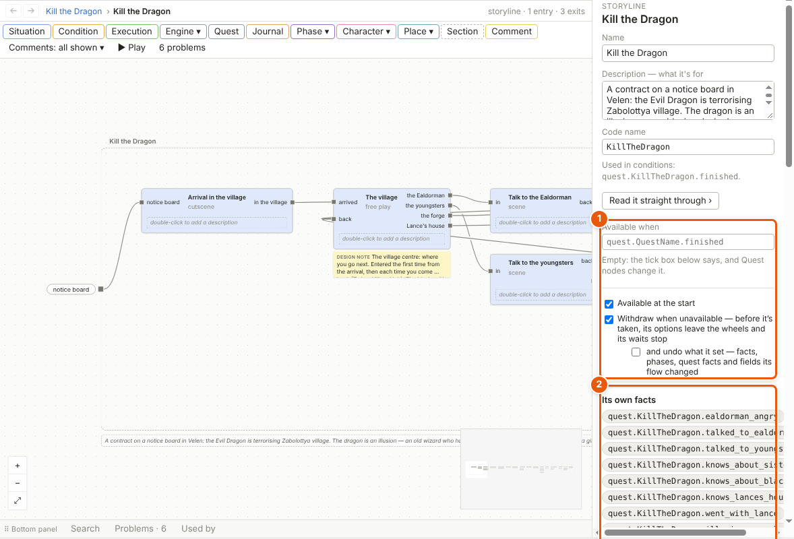
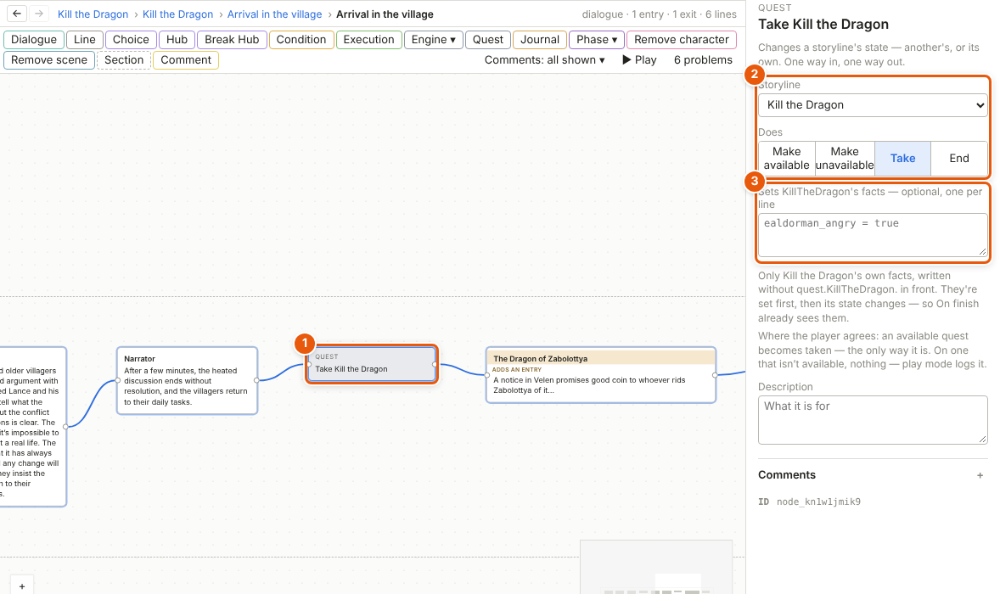
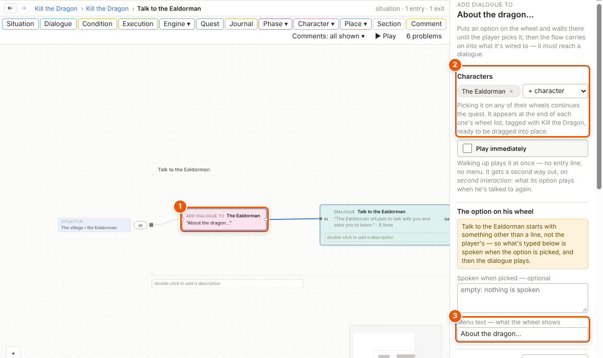
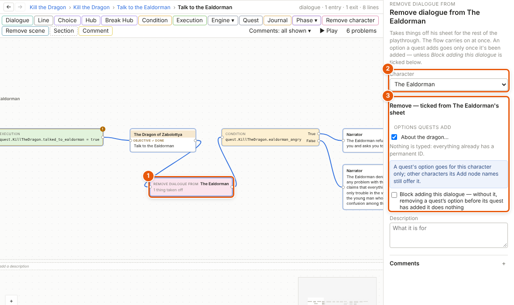
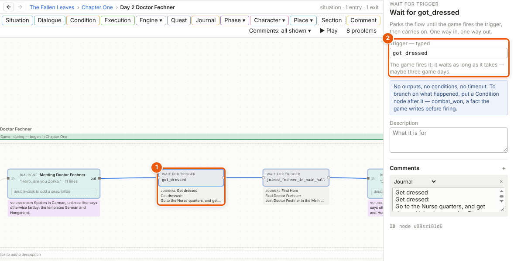

# Quests, events and triggers

Every [storyline](glossary.md#s) is a quest, with a state the game keeps: unavailable, available, taken, finished or failed. Quest nodes change that state; Add and Remove nodes put options on characters' [wheels](glossary.md#w) — the menu the player gets when he talks to someone — and take them off; engine events and triggers are how the story and the game talk to each other.

1. When the quest is available, and what happens if it stops being so. 2. Its own facts.

## Set up a storyline as a quest

1. Make a storyline with *Project ▸ New storyline*, or open one from the Project tab. Click empty canvas to see its details.
2. Its **Code name** is how conditions read it: *quest.KillTheDragon.finished*.
3. Under **Available when**, type a [condition](glossary.md#c) — *quest.TrollBeer.finished* makes it follow another quest. Leave it empty and the **Available at the start** box decides; Quest nodes can change it later.
4. Leave **Withdraw when unavailable** ticked unless you have a reason: if the quest stops being available before it's taken, the options it put on wheels go and its waits stop. **and undo what it set** also puts back what its flow changed — facts, phases, quest facts and fields.
5. Each of the storyline's exits is an outcome, marked **✓ finished** or **✗ failed**. To change one, double-click the **✓** or **✗** in front of the exit's name on the frame (the dashed box around the canvas, with the exits on its right) and pick. Or click it in the details, under **Outcomes — exit pins**.
6. Under **On finish** and **On fail**, type facts to set when it ends, one per line, as in an [Execution node](glossary.md#e).

A quest becomes *available* by its condition, its tick box or a Quest node; as it does, its flow — the story moving along its arrows — sets off from its entries. It is *taken* only by a Quest node, where the player agrees. It is *finished* or *failed* when its flow leaves by an exit, or a Quest node ends it.

## Take, end or unlock a quest: the Quest node

1. Click **Quest** on the toolbar. The node appears in the middle of the view: wire it in where the flow passes (1).
2. Pick the **Storyline** it changes — its own, or another quest — and what it **Does** (2): **Make available**, **Make unavailable**, **Take** or **End**.
3. For **End**, pick the exit it ends through, under **Through exit**. For **Make available** and **Make unavailable** on a quest with a condition, tick **Override condition** to change it whatever the condition says.
4. Optionally, under **Sets KillTheDragon's facts — optional, one per line** (3), type that quest's own facts to set, without *quest.KillTheDragon.* in front: *ealdorman_angry = true*. They're set first, then the state changes.

A new Quest node is set to **Take**. On a quest that isn't in the right state — taking one that isn't available, say — it does nothing, and [play mode](glossary.md#p) logs it.

## Put a conversation on a character's wheel: Add dialogue to

1. On a storyline's or situation's canvas, click **Character ▾** on the toolbar and pick **Add dialogue to**.
2. Wire it in front of the dialogue it should play (1), or of a [situation](glossary.md#s) with that dialogue in it.
3. Under **Characters**, pick who offers it (2). Name several and picking it on any of their wheels continues the quest.
4. Type its **Menu text — what the wheel shows** (3): *About the dragon…*.
5. Pick what happens **Once picked** — it **disappears** and the quest moves on, **greys out**, or **stays as it was** — and **When it's over**: **back to the wheel**, or **the talk ends**.

When the quest's flow reaches the node, the option appears on the characters' wheels and the flow waits there until the player picks it. An Add dialogue to node right after the quest's entry is on the wheel as soon as the quest is available: that's how a quest giver offers a quest. The option also shows at once in each character's [sheet](glossary.md#s), ready to be dragged into place — see [Characters](characters.md).

Tick **Play immediately** to play it as soon as the player walks up, with no menu. The node then gets a second way out, *on second interaction*, for what his option plays when he's talked to again.

## Take things off a wheel: Remove dialogue from

1. On a storyline's or situation's canvas, click **Character ▾** and pick **Remove dialogue from**. On a dialogue's canvas, click **Remove character**: it makes the same node.
2. Wire it where the flow passes (1). It takes things off and the flow carries on at once.
3. Pick the **Character** (2), then tick what to take off his sheet (3): his own dialogues, options quests add, [entry lines](glossary.md#e), [one-liners](glossary.md#o), or whole [pools](glossary.md#p). Nothing is typed.

An option a quest adds goes only once it has been added. Tick **Block adding this dialogue** to keep it from ever being added if the node is passed first. Most of the time an option set to disappear once used is all you need; this node is for the rest.

## Tell the game something, and wait for it: events and triggers

1. Click **Engine ▾** on the toolbar and pick **Engine event** or **Wait for trigger**.
2. For an **Engine event**, type its name under **Event — typed; its name in Unreal** — *start_combat*, *play_sequence*. Add arguments with **+ argument**, choosing a type: yes/no, number, text, a character or a location. The flow carries on at once.
3. For a **Wait for trigger** (1), type the trigger's name under **Trigger — typed** (2) — *combat_ended*, *got_dressed*. The flow waits there until the game fires it, however long that takes.
4. A new name joins the project's list by itself. *Tools ▸ Engine events* and *Tools ▸ Triggers* list them, with their arguments and where each is used.

To branch on what happened, have the game set a fact before it fires the trigger — one with **The game writes it too** ticked — and put a Condition node after the wait: start the fight, wait for *combat_ended*, then check *combat_won*.

## Details and tips

- **Quests touch each other through conditions.** *quest.KillTheDragon.finished* to follow another quest, *not quest.Banishment.taken* to be locked by one. Several quests can be available at once.
- **A quest's state never adds or removes an option by itself.** An option goes when it's picked, by its option condition (*Option condition — when it's offered*, in the Add dialogue to node's details), or by a Remove dialogue from node. The one exception is a quest with **Withdraw when unavailable** ticked: its waiting options go if it stops being available before it's taken, those on its other ways go once it's taken, and all of them go when it ends.
- **Play mode stands in for the game.** In the play window, the game panel lists every Wait for trigger that's waiting, with a **Fire** button for each — *Fire got_dressed* — and a box for each fact the game writes, to set it before the trigger fires. It also lists the engine events sent. See [Play mode and the playable HTML file](play-mode.md).
- **Places work the same way.** *Add scene to* and *Remove scene from*, under **Place ▾**, do for a location's scene list what these nodes do for a wheel — see [Locations and scene lists](locations.md).
- **The problems list watches the wiring.** An Add dialogue to node whose way out never reaches a dialogue shows there — see [The validator](validator.md).

---
← [Facts, conditions and world states](facts-and-conditions.md) · [Guide home](README.md) · [Phases](phases.md) →

Spec: §4.4, §4.15, §4.16, §5.6, §5.8
