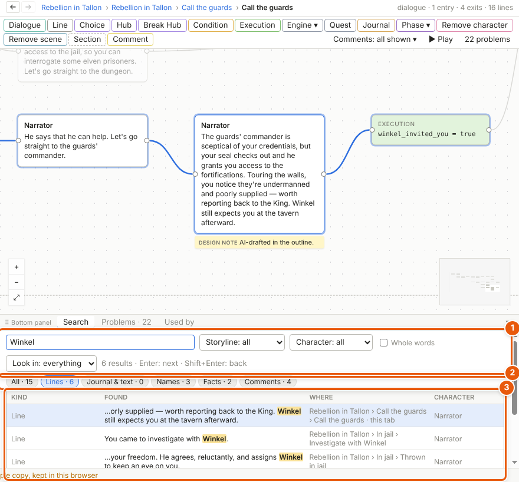
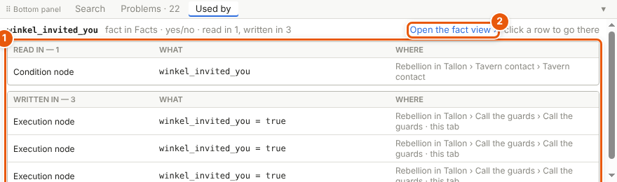
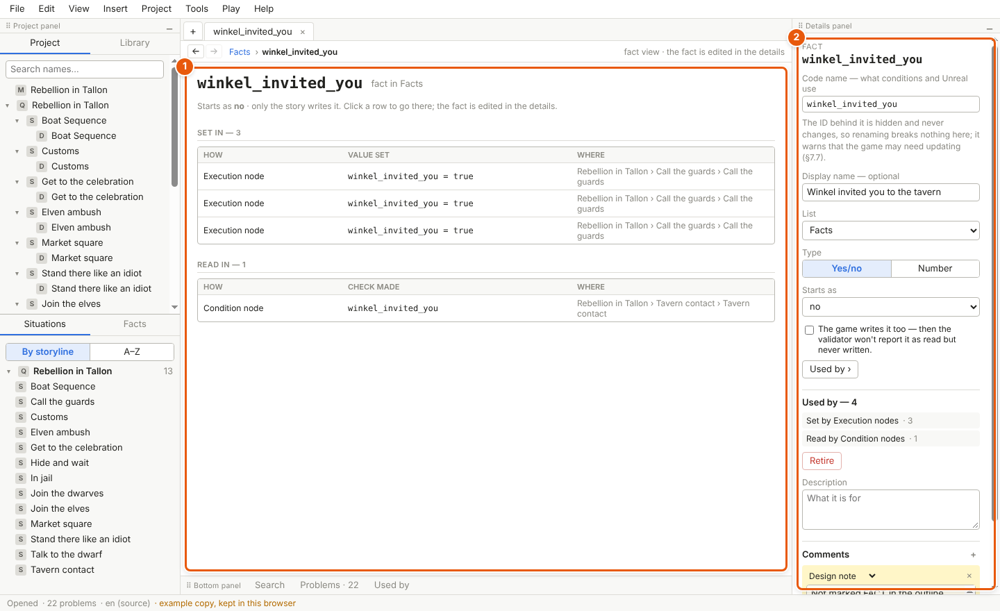
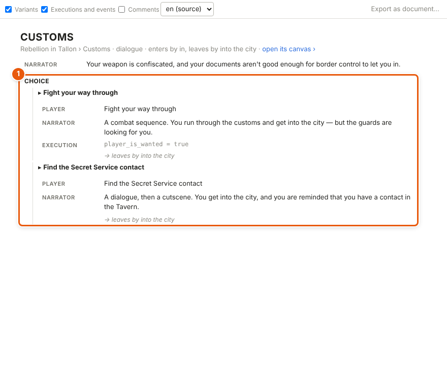
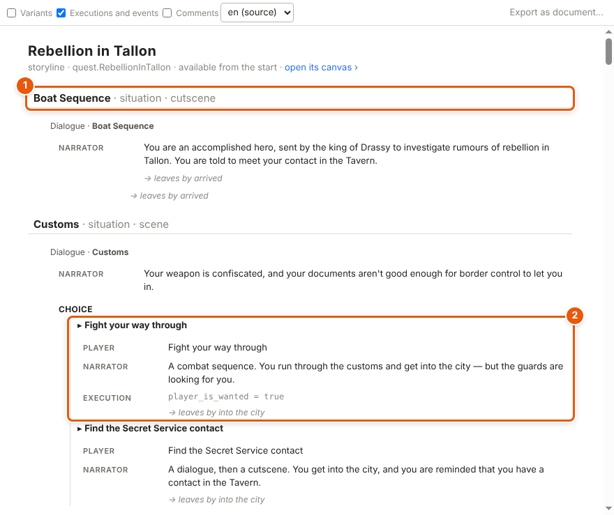

# Reading tools

A quest grows past what you can hold in your head. The reading tools find any word, show everywhere something is used, and let you read a dialogue or a whole [storyline](glossary.md#s) straight through, like a script. They are ways of looking: opening one changes nothing.

## Find a word anywhere

1. Press **Ctrl+F**, or choose *Edit ▸ Find…*. The bottom panel opens on its **Search** tab, with the cursor in the box (1).
2. Type a word or a name. Results appear as you type.
3. Narrow them if you need to: pick a storyline in *Storyline: all* to keep only what's in it, pick a character in *Character: all* to keep only the lines he speaks, and tick *Whole words* to match *dragon* but not *dragons*.
4. Click a kind of result to see only that kind (2): *Lines*, *Journal & text*, *Names*, *Facts* or *Comments* — each with how many it found. Click it again, or *All*, for all of them.
5. Click a result (3). Its canvas or page opens, with it selected; the other results on that canvas are outlined. **Ctrl+click** opens it in a new tab.
6. Press **Enter** in the search box to go to the next result, **Shift+Enter** to go back. **Escape** folds the panel away.

Search reads everything: the words of every line, with its [variants](glossary.md#v) and [menu text](glossary.md#m); names and [code names](glossary.md#c); [facts](glossary.md#f) and [phases](glossary.md#p); comments; the [journal](glossary.md#j), the [codex](glossary.md#c) and [interface text](glossary.md#i).

## Search by a field

When your templates give things fields (see [Templates and fields](templates.md)), you can search by them.

1. In the Search tab, open *Look in: everything* and pick what to look in — lines, characters, a kind you added.
2. Click **+ Filter**. Pick a field, a test (*is*, *is at least*, *has the words* …) and a value.
3. Add more filters if you need them. Every filter must hold.

## See everywhere something is used

1. Select something: a node on a canvas, a placed situation (a [placement](glossary.md#p)), a fact, a character.
2. Open the **Used by** tab of the bottom panel. Or right-click the thing and choose **Used by**.
3. The uses are listed by how they use it (1). For a fact, where it's read and where it's written, in two groups. For a [situation](glossary.md#s), every place it's placed, with the pins wired there. For a character, the lines he speaks, the options put on his [wheel](glossary.md#w), and the links to him.
4. Click a row to go there. Uses on the canvas in front are outlined.

The *N places* link beside a fact in a list of facts, and the **Used by ›** button in a fact's details, open the same list.

## Read one fact

A **fact view** shows one fact in a tab: what it starts as, everywhere it's **set** (with the value), and everywhere it's **read** (with the check made), in story order.

1. Open it one of these ways:
   - *View ▸ Fact view…*, then pick the fact, phase or faction's [reputation](glossary.md#r).
   - **Open the fact view ›** at the top of Used by (2 in the Used by picture).
   - **Fact view ›** in the fact's details.
2. Click a row to go there (1).
3. Change the fact itself in the details panel on the right (2): its code name, type, starting value and the rest.

## Read a dialogue as a script

1. Open a dialogue's canvas.
2. Choose *View ▸ Script view*. Or click **Read as script ›** in the dialogue's details.
3. The dialogue reads top to bottom, like a screenplay: who speaks, then what they say. At a [choice](glossary.md#c) or a [hub](glossary.md#h), each option is an indented block that starts with ▸ (1). When [Condition](glossary.md#c) nodes stand on an option's way, their checks follow its name in brackets.
4. Use the boxes at the top to show or hide **Variants**, **Executions and events** and **Comments**. The language list beside them shows the source language: translations come in a later version.
5. Click a line to see it, and edit it, in the details panel. Click **open its canvas ›**, under the title, to go back to the graph.
6. In the [breadcrumb](glossary.md#b) at the top, click the storyline or a situation to read the whole storyline straight through from there (below).

## Read a whole storyline straight through

1. Open a storyline, or anything inside it.
2. Choose *View ▸ Storyline view*. Or click **Read it straight through ›** in the storyline's details, which show on its canvas when nothing is selected, or on the project map when you select the storyline there.
3. Every situation the storyline places comes in the order the arrows run (1), each with its dialogues written as in the script view. A branch is an indented block (2). A situation reached a second time is named, not repeated.
4. Click a situation to open its canvas, a dialogue to read it on its own as a script, a line to see it in the details. **open its canvas ›**, under the title, goes to the storyline's graph.

## Read everything one character says

1. Choose *View ▸ Character view…* and pick a character.
2. His sheet opens at *Everything he says*: every line he speaks in a dialogue, grouped by storyline, situation and dialogue, each with its variants. His entry lines and one-liners are higher up the same sheet. You can edit the lines right there. See [Characters](characters.md).

## Details and tips

- **Ctrl+click** a result, a row or a link to open it in a new tab and keep your place.
- *Export as document…* in the script and storyline views is greyed: documents come in a later version.
- To see how lines read in one moment of the game — a phase, a set of facts — use the phase view and world states: see [Phases](phases.md) and [Facts, conditions and world states](facts-and-conditions.md).
- The **Problems** tab, beside Search and Used by, is the validator's list: see [The validator](validator.md).

---
← [The journal, the codex and interface text](journal.md) · [Guide home](README.md) · [Play mode and the playable HTML file](play-mode.md) →

Spec: §7.11
