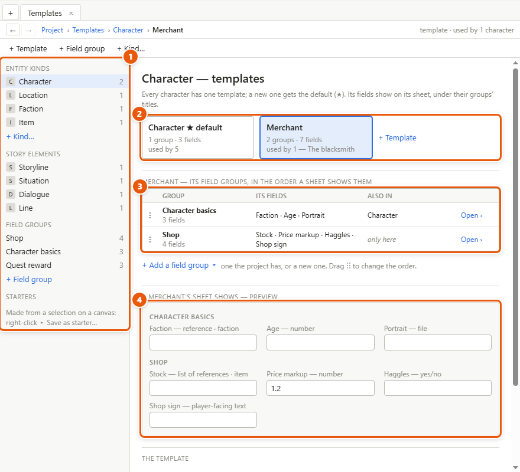
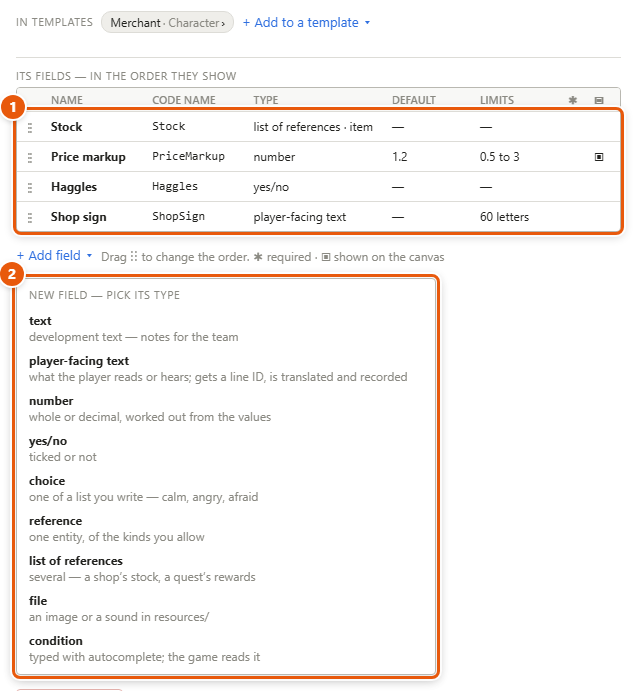
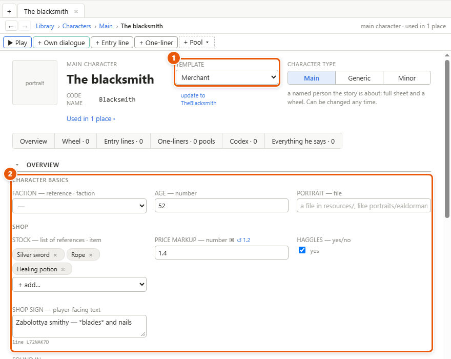
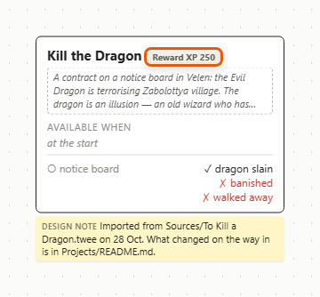

# Templates and fields

A **template** is a set of fields you make for one kind of thing in your project — characters, places, storylines, lines — so it carries the data the game needs: a merchant's prices, a quest's reward, a line's emotion. Fields come in **field groups** — named lists of fields, made once and put into any number of templates — and every **element** on a template — each character, place, storyline or line that uses it — has the same fields, filled in on its sheet or in its details.

*In the picture: **1** the list — kinds of entity, story elements, field groups, starters; **2** the kind's templates as cards, ★ the default; **3** the open template's field groups, in the order a sheet shows them; **4** a preview of what a character on it shows.*

## Open the Templates page

1. Choose *Project ▸ Templates…*. It opens as a tab.
2. On the left, pick a kind: an **entity** kind — the things in the [Library](glossary.md#l): *Character*, *Location*, *Faction*, or one of your own, like *Item* — or a story element (*Storyline*, *Situation*, *Dialogue*, *Line*).
3. Its templates show as cards. Click one to open it below.

Each kind has one or more templates and a **default** one (★), which new elements of that kind get. *Merchant* is a second template of *Character* in Kill the Dragon.

## Make a template

1. With the kind open, click *+ Template* (on the page's toolbar, or beside the cards). It opens below, as *New character template* for a character.
2. Under *The template*, type its *Name* — *Merchant*. Its *Code name* — the name the game knows this template by — follows the name, *Merchant* too, until you type a code name of your own.
3. Click *+ Add a field group ▾* and pick a group the project has, or *New field group…*. Drag a group by ⋮⋮ to change the order.
4. To make it the kind's default, click *Make default*. Elements on the old default stay on it.
5. *Delete template…* moves its elements to the default; values that would go are listed first, and one undo brings them back. The default itself can't be deleted: make another the default first.

## Make a field group and its fields

1. Click *+ Field group* on the page's toolbar, name it — *Shop* — and click *Create*. Or open one under *Field groups* on the left.
2. Its fields are a table (**1**): name, code name, type, default, limits; ✱ required, ▣ shown on the canvas.
3. Click *+ Add field ▾* and pick one of the nine types (**2**). The new field is selected, its *Name* ready to type in the details.
4. Click a field to change its settings in the details: its type, its default, its limits, *Required*, *Show on the canvas*, *Changes during play* (offered on a yes/no, number, choice or reference field of an entity kind) and a tooltip. A choice field's choices go under *Choices*: type each into *+ Add choice* and press *Enter*.
5. *+ Add to a template ▾* puts the group into another template too. Editing a group changes every template that has it.

The nine types:

| Type | Holds |
|---|---|
| text | notes for the team |
| player-facing text | what the player reads or hears. It gets a **line ID** — a permanent code of its own, so its translations and recordings can follow it once those come |
| number | whole or decimal |
| yes/no | ticked or not |
| choice | one of a list you write — *calm*, *angry*, *afraid* |
| reference | one entity, of the kinds you allow |
| list of references | several — a shop's stock, a quest's rewards |
| file | an image or a sound in the project's *resources* folder |
| condition | a condition, typed with suggestions; the game reads it |

## Fill in an element's fields

1. Open the element — a character's sheet, a storyline's details, a line's details.
2. Pick its template (**1**): beside its name on a sheet, beside *Template* in the details.
3. Fill in its fields, under their groups' titles (**2**). A field left at its default shows the default greyed; once you've typed your own value, ↺ and the default, beside the field's name, bring the default back.
4. To add a field, go to its template: on a sheet, *Open Merchant in Templates ›* in the details panel; anywhere, *Edit templates ›* at the bottom of the template list.

## Show a field on the canvas

1. On the Templates page, open the field's group and click the field.
2. In its details, tick *Show on the canvas*.
3. Its value is now drawn on each element's node or box — small, in the header's corner, and only where it isn't the default. A yes/no draws its name, or *not* and its name; a number its name and value — *Reward XP 250*; any other field its value.

## Starters

A **starter** is a ready-made group of nodes and arrows — a merchant's conversation: greeting, hub, buy, sell, goodbye — that you insert anywhere as a fresh copy.

1. Select the nodes on a canvas and choose *Edit ▸ Save as starter…* (or right-click ▸ *Save as starter…*), name it and click *Save starter*.
2. To use it, choose *Insert ▸ Starter* and pick it. A starter goes only into the kind of canvas it was made on — storyline, situation or dialogue. The copy is a new thing, with its own line IDs, and is never linked to the starter.
3. Starters are listed on the Templates page under *Starters*. Click one to see what it holds; *Insert into… ▾* there puts a copy into any canvas of its kind.

## Details and tips

- **Changing a template changes every element on it.** Removing a field or a group, or changing a field's type, first lists the values that would go; one undo brings them back. With nothing to lose, it's simply done.
- **Switching an element's template** keeps the values for fields both templates have, and lists the rest first.
- **Fields are added to a group, never to one element.** A note on one element is a comment.
- **Code names** are what the game reads: *Merchant.PriceMarkup*. A field's code name follows its name while it's still the one made from it; one you typed yourself stays.
- **A field that changes during play** is read in conditions and set by [Execution nodes](glossary.md#e): *Borvin.mood = calm*. The value on each sheet is where it starts. Play mode's debug panel can set it too.
- **Search** can filter by field values: *lines where Emotion is angry* (see [Reading tools](reading-tools.md)).
- *+ Kind…*, on the Templates page, makes a kind of your own — items, creatures. Name it and click *Create*: it gets a heading in the Library and a default template.

---
← [Locations and scene lists](locations.md) · [Guide home](README.md) · [The journal, the codex and interface text](journal.md) →

Spec: §4.21
