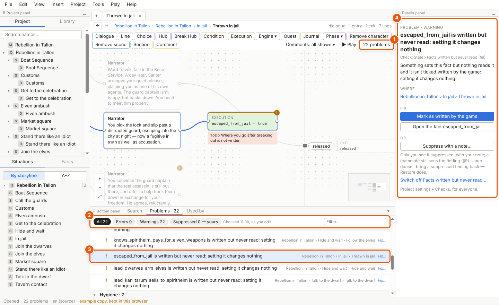
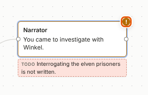
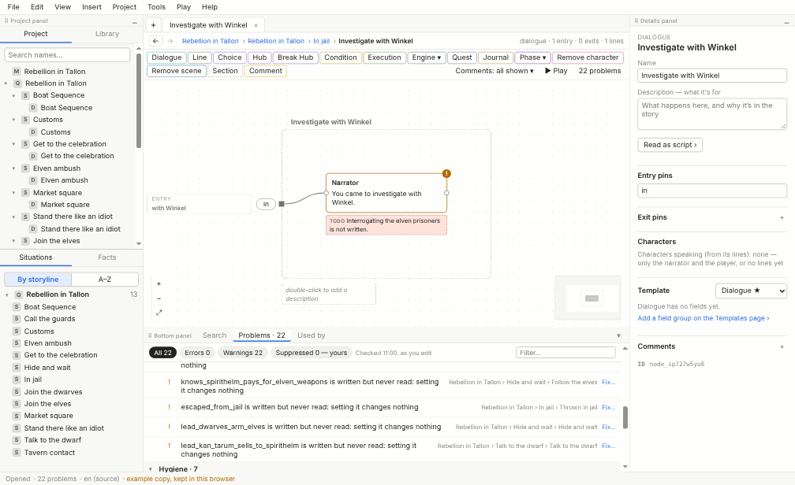
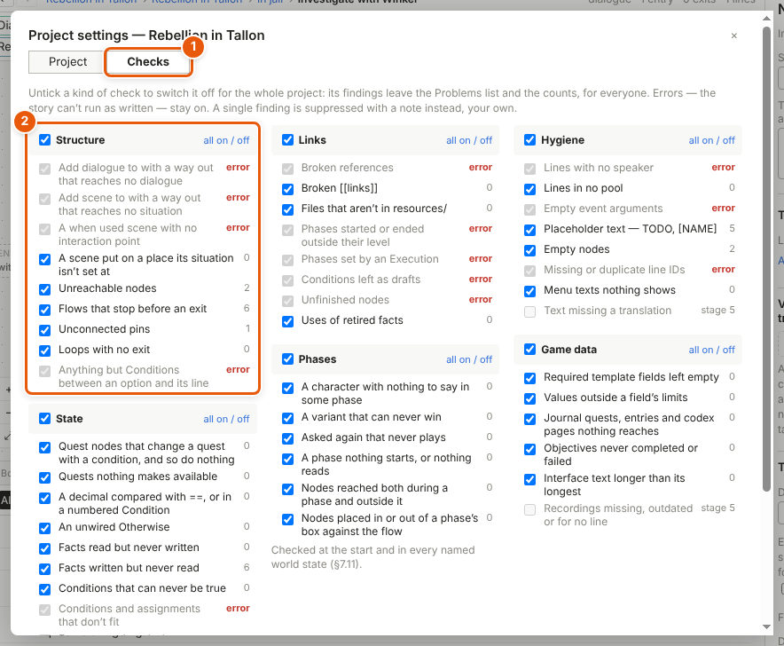

# The validator

The validator checks your project without playing it. It finds what can't run as written — a missing speaker, a broken reference — and what looks like a hole: a line that leads nowhere, a [fact](glossary.md#f) set but never read. It runs by itself as you edit, and lists each thing it finds — a [finding](glossary.md#f) — in the **Problems** tab.

## Look at what it found

1. Click the count on the canvas toolbar, such as *22 problems* (1). Or open the **Problems** tab of the bottom panel. The status bar shows the same count.
2. The findings come in groups — *Structure*, *State*, *Links*, *Phases*, *Hygiene* and *Game data* — and inside each group, by kind of check. Click a group's or a kind's title to fold it.
3. Click a chip (2) to see **All**, only the **Errors**, only the **Warnings**, or what you've **Suppressed**. Type in *Filter…* to narrow the list.
4. Click a finding (3). Storyliner goes to it, and its details open on the right (4): what's wrong, which check found it and why it matters, where it is, and how to fix it.
5. Once you've clicked a finding, press **Enter** for the next one, **Shift+Enter** for the one before.

## Fix a finding

1. Click the finding.
2. In its details, under **Fix**, click a fix if it offers one — *Mark as written by the game*, *Assign speakers…*, *Open the fact …* and others.
3. Or click the place under **Where** and fix it by hand.
4. The finding leaves the list once the validator checks again, a moment after you stop typing.

A fix that changes the project is an ordinary edit: **Ctrl+Z** undoes it, and the finding comes back.

## Spot findings on the canvas

A [node](glossary.md#n) on a canvas with a finding wears a badge at its top right: **!** for a [warning](glossary.md#w), **×** for an [error](glossary.md#e). Hover over the badge to read what's wrong. A finding on a sheet or a page has no badge: find it in the Problems tab, and click it to go there.

## Suppress a warning, with a note

Some warnings are fine as they are: a fact the game's own code reads, a scene not written yet. Suppress them, so the list shows only what needs you.

1. Click the warning. Or right-click its row.
2. Click **Suppress with a note…**.
3. Write why it's fine in *Note — why it’s fine*.
4. Click **Suppress**. It leaves the list and the counts.
5. To see it again, click the **Suppressed** chip. Each one shows your note, with **Edit note** and **Restore**.

A suppression is yours alone. It's kept in your own view settings, beside the project, not in the project file: a teammate still sees the finding. So suppressing isn't an edit, and **Ctrl+Z** doesn't bring a finding back — **Restore** does. A suppression goes by itself when the thing it's about is deleted, or when the finding stops being true.

## Switch off a kind of check, for everyone

1. Choose *File ▸ Project settings…* and click **Checks** (1). Or, in a warning's details, click the *Switch off …* link that names its kind.
2. Every kind of check is listed under its group, with how many findings it has now (2).
3. Untick a kind to switch it off. Its findings leave the list and the counts. Click **all on / off** to switch a whole group.

This is saved in the project, so everyone sees the same list. Switching a kind off is one undo step.

## Details and tips

- **Errors** mean the story can't run as written: a broken reference, a condition left as a draft, a line with no speaker. An error can't be suppressed or switched off. It stays listed until it's fixed.
- **Warnings** are everything else. Each can be suppressed with a note, or its kind switched off.
- The counts on the toolbar, the tab and the status bar leave out what's suppressed and what's switched off.
- A fact ticked *The game writes it too* in its details is never reported as read but never written, or written but never read: the game may do either.
- When your project has named world states, the phase checks run in each of them too. See [Facts, conditions and world states](facts-and-conditions.md).
- Checks for translations and recordings come in a later version; they show greyed in the Checks tab.
- Importing a quest shows the validator's findings in its report. See [Importing](importing.md).

---
← [Play mode and the playable HTML file](play-mode.md) · [Guide home](README.md) · [Importing](importing.md) →

Spec: §9
